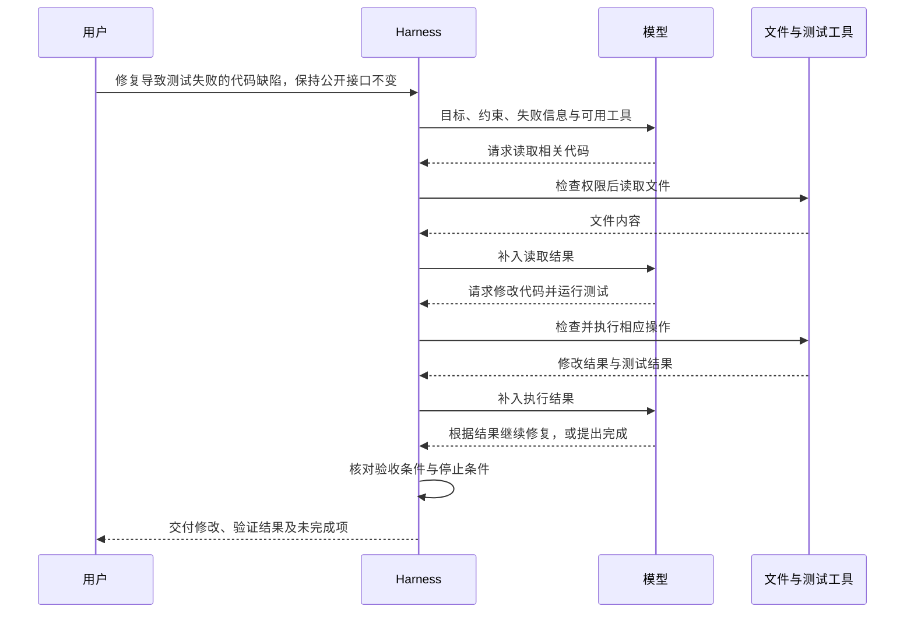
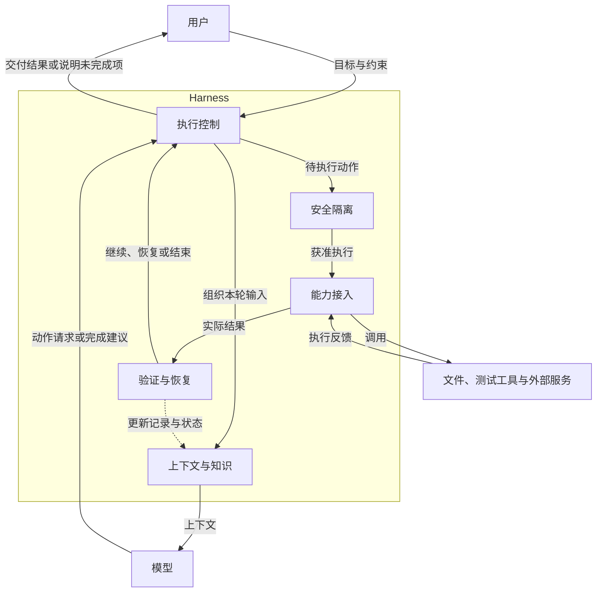
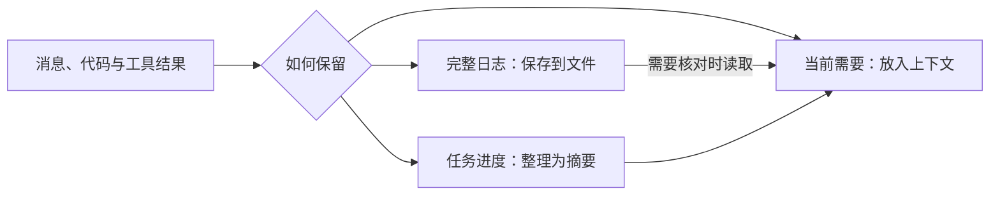
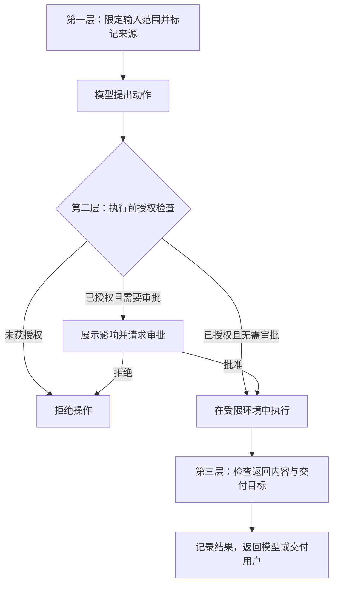
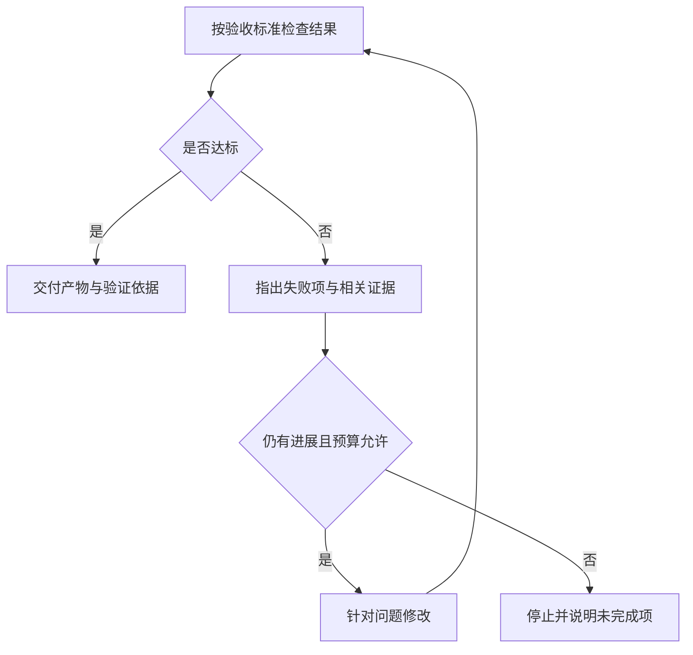

## 1. Agent 与 Harness 架构

### 1.1 一次任务的执行闭环

让大语言模型（Large Language Model，LLM）解释测试失败的原因，它可以根据输入给出分析。让它实际修复导致测试失败的代码缺陷，还需要读取代码、修改文件、运行测试，并根据结果继续处理。这些操作由模型之外的程序执行。

Agent（智能体）把模型判断与外部操作连接成循环。以修复代码缺陷为例，一次任务可能这样推进：



其中，**模型根据当前信息提出下一步动作；Harness（运行时框架）组织信息、执行获准的动作，并把结果交回模型。** 文件系统、测试程序等提供实际操作环境。

模型输出“运行测试”只是一项请求。Harness 必须真正调用测试程序，下一轮模型才能知道测试通过、失败，还是根本没有启动。这个反馈会改变后续动作，因此整个任务可能需要多轮模型调用。

### 1.2 Harness 的主要模块

上面的循环能够推进任务，但长任务还会遇到信息过多、工具不可用、误操作和执行中断等问题。Harness 围绕这些问题承担五组职责，第 2—6 章分别展开。

| 职责 | 解决的问题 | 在代码缺陷修复任务中的作用 |
|---|---|---|
| [执行控制](#2-执行控制) | 决定如何推进与何时停止 | 安排排查步骤，避免反复修改却没有进展 |
| [上下文与知识](#3-上下文与知识) | 给模型提供当前需要的信息 | 保留接口约束，选择相关代码和错误日志 |
| [能力接入](#4-能力接入) | 把动作请求交给实际执行端 | 接入文件读写和测试工具，回传真实结果 |
| [安全隔离](#5-安全隔离) | 限制可以访问和修改的范围 | 允许修改项目文件，限制访问密钥与无关目录 |
| [验证与恢复](#6-验证与恢复) | 确认结果，并在中断后继续 | 检查测试与代码变更，恢复尚未完成的工作 |

这五组职责作用于同一个执行循环，不要求分别部署为五个服务。下图展示 Harness 内部各模块与模型、外部工具的关系；实线表示主要调用与反馈路径，虚线表示结果对上下文和任务状态的更新。



安全隔离还约束上下文读取和结果交付；图中突出执行前的权限检查。验证结果回到执行控制后，系统才能决定继续工作还是结束任务。

## 2. 执行控制

代码缺陷修复的目标可以事先确定，具体要读哪些文件、尝试几次修改，往往要看到中间结果才能决定。执行控制负责安排这些动作，同时限制无效探索。

### 2.1 固定流程与动态决策

工作流（Workflow）由代码预先规定步骤和分支；Agent 则让模型根据反馈选择下一步。选择的依据是任务中有多少过程能够提前确定。

- **固定流程**：格式化代码、运行指定测试、汇总结果，执行顺序通常稳定。用代码编排，便于测试和估算耗时。
- **动态决策**：测试失败后，可能需要追踪调用关系、检查配置或修改实现。允许模型根据证据选择动作，可以应对事先没有列出的情况。
- **混合架构**：用固定流程约束入口、权限和验收，在排查阶段允许模型探索。例如模型可以选择修复方案，但提交修改前必须运行指定检查。

混合架构把探索集中在确实存在不确定性的环节。即使模型认为某一步可以省略，程序规定的权限与验收检查仍然要执行。

### 2.2 ReAct 与 Plan-and-Execute

最直接的执行方式是看一次结果，再决定下一步。[ReAct](https://arxiv.org/abs/2210.03629) 将推理与行动交替组织：模型根据观察选择操作，再用新的工具反馈修正判断。它适合下一步高度依赖当前结果的任务。

但任务较长时，只关注眼前反馈可能遗漏后续工作。例如修复了当前报错，却忘记检查公开接口是否改变。规划后执行（Plan-and-Execute）先把任务拆成阶段步骤，再在执行过程中记录各阶段的完成情况，并根据新发现调整后续步骤。

它可以与 ReAct 结合：先明确整体步骤，每个阶段内再根据工具反馈逐步行动。具体过程如下：

1. **拆分步骤**：执行前明确定位原因、修改实现、验证结果等阶段及各自的完成条件。
2. **执行并记录进度**：根据工具反馈选择操作，记录已完成步骤和待处理问题。
3. **调整后续步骤**：发现原因判断有误时，更新排查方向，同时保留接口检查等必要工作。

预先列出的步骤可以调整，避免后续操作持续建立在未经验证的猜测上。

### 2.3 多智能体分工

多智能体（Multi-agent）让多个智能体分别维护上下文、执行子任务，再交换结果。它在工作可以有效拆分时有价值：一个执行者检查实现，另一个检查测试覆盖，各自只需加载相关资料。

常见组织方式的区别在于任务由谁分配、成员如何交流：

- **主从委派**：主智能体拆分任务，子智能体回报结果，由主智能体整合。任务可以在执行中动态创建。[Codex Subagents](https://learn.chatgpt.com/docs/agent-configuration/subagents)、[Claude Code Subagents](https://code.claude.com/docs/en/sub-agents) 和 [Kimi Agent Swarm](https://www.kimi.com/en/help/agent/agent-swarm) 都可作为相关实现的参考；Agent Swarm 更强调大规模并行编排。
- **团队协作**：负责人协调进度，成员通过共享任务和直接通信处理依赖。[Claude Code Agent Teams](https://code.claude.com/docs/en/agent-teams) 是相关实现的参考，适合需要成员持续交换发现的工作。

分工也会产生代价。两个执行者同时修改同一文件，可能互相覆盖；只回传结论而不提供依据，主智能体难以验证结果。因此，委派时要明确工作范围和交付内容，汇总时要检查证据与冲突。子任务越依赖彼此的实时进展，并行带来的收益越容易被协调成本抵消。

### 2.4 进展判断与停止条件

循环能够继续运行，不等于任务正在接近完成。重复读取同一文件、原样重试失败操作，都可能消耗资源却没有增加有效信息。

运行时需要同时检查进展与预算：

- **有新进展**：获得新证据、排除一种原因，或通过一项检查，可以继续。
- **没有新进展**：要求模型调整方法、补充缺失信息；持续无效时停止。
- **达到资源上限**：根据步数、时间或费用限制结束执行，保存进度并说明未完成项。

完成任务与耗尽预算是两种不同的结束原因。最终报告应明确区分，结果验收的方法见第 6 章。

## 3. 上下文与知识

模型每次判断都依赖本次收到的信息。执行过的工具、保存的文件和此前发现的事实，只有被放入上下文，或被再次读取，才能影响这一步判断。因此，Harness 需要持续选择和维护信息。

### 3.1 当前输入与持久记录

代码缺陷修复过程中，完整日志可能很长，而下一步只需要报错位置、相关代码和接口约束。保存完整记录与提供当前输入，是两个不同的工作。可以按用途区分四种信息：

- **上下文（context）**：这次调用实际交给模型的内容，例如相关代码与最新测试错误。
- **任务状态（state）**：任务进行到哪里，例如已修改哪些文件、哪些检查尚未完成。
- **历史（history）**：发生过什么，例如历次读取、修改和测试的原始记录。
- **记忆（memory）**：后续任务可以复用的信息，例如项目采用的测试命令和已确认的工作约定。

历史中的一次测试失败，不应自动成为“这个项目的测试无法通过”这样的长期记忆。前者记录一次事件，后者会影响未来判断，需要更充分的依据。

存储方式随用途选择：项目约定适合可审查的文档，任务状态适合可靠的结构化存储，大日志和产物可以单独保存。只有需要从大量记录中按内容寻找信息时，才进一步考虑全文或向量检索；相关方法见 [RAG 检索系统](/articles/rag-retrieval-systems/)。

### 3.2 长任务中的信息取舍

如果每轮都附上全部历史，日志与重复内容会不断增加，既占用上下文，也可能掩盖早期的重要约束。直接删除旧消息又可能丢失“保持公开接口不变”这样的要求。

处理长任务时，可以分别安排当前信息、旧记录和继续执行所需的摘要：



摘要应保留目标与约束、已完成工作、关键证据的位置、失败尝试和下一步。只写“已完成初步排查”，无法帮助后续执行；写清排除了什么原因、依据在哪里，才能避免重复尝试。

压缩会丢失细节，因此重要判断仍需能回到原始记录核对。

### 3.3 记忆的写入与读取

跨任务复用知识可以减少重复探索，但错误或过期的记忆也会反复影响决策。例如项目已经更换测试命令，继续沿用旧约定就会让每次任务都从错误操作开始。

#### 3.3.1 写入：保留经过确认的可复用信息

- **时机**：任务结束或新事实得到确认后，再判断是否值得长期保留。
- **内容**：项目约定、用户明确表达的偏好、经过验证的方法；临时猜测留在当前任务记录中。
- **路径**：从记录中提取候选，核对来源和保存权限，再更新已有记忆。新旧约定冲突时，明确替代或失效关系，避免两条同时生效。

记忆还应保留来源和适用范围。某个分支中的临时做法，不能直接变成整个项目的通用规则；涉及敏感信息时，还要限制保存与读取范围。

#### 3.3.2 读取：核对当前任务是否适用

- **时机**：开始任务，或执行中缺少既有约定与经验时。
- **内容**：与当前目标、项目和版本相关，且允许访问的记录。
- **路径**：先限定范围，再查找候选；核对有效时间与来源后，将必要内容加入上下文。

当记忆与当前文件冲突时，应检查差异的来源，不能仅因记忆曾经有效就继续采用。记忆用于帮助判断，实际业务状态仍需从对应系统核实。

### 3.4 Skill：按需加载任务方法

记忆可以保存“项目使用什么测试命令”，技能（Skill）则组织“这类任务应怎样完成”。技能与普通提示词的区别主要在组织和复用方式：它把任务说明、参考资料、脚本和模板放在一个可维护的资源包中，供相关任务按需读取。

以代码缺陷修复为例，技能可以说明如何复现问题、哪些接口不能修改、需要执行哪些检查。模型仍然根据具体错误选择操作；技能提供的是方法与约束。

为了避免每次任务都加载全部资料，技能通常分层提供信息：

1. **先看名称与简介**：判断是否适合当前任务。
2. **匹配后读取入口说明**：如 `SKILL.md`，了解流程和验收要求。
3. **执行中按需读取资料或运行脚本**：只加载当前步骤需要的内容。

这种方式称为渐进披露（progressive disclosure）。它降低了无关流程占用上下文的机会，但能否选对技能，仍取决于清晰的适用范围与说明。技能中的指令也不能授予额外权限，实际动作继续由运行时检查。

## 4. 能力接入

有了目标和相关信息，模型还需要一种方式表达动作。能力接入负责把这个请求交给正确的工具或远端智能体，并把执行结果带回循环。

### 4.1 工具调用：从请求到执行

函数调用（Function Calling，也称工具调用）让模型输出工具名称和参数。应用事先提供工具说明与参数结构，模型据此生成请求，应用再检查并执行。

例如，读取文件的请求可以用以下 JSON 表达。这里展示的是动作内容，各模型接口的外层格式可能不同：

```json
{
  "name": "read_file",
  "arguments": {
    "path": "src/payment.py"
  }
}
```

应用收到请求后，先检查参数和权限，再执行读取并返回结果：

- **参数是否合规**：是否提供了 `path`，值是否为字符串。JSON Schema 用于声明这类结构约束。
- **操作是否获准**：路径是否在允许访问的目录内。参数格式正确，不代表访问被授权。
- **执行是否成功**：工具可能返回文件内容，也可能报告文件不存在或读取失败。模型需要收到实际结果才能继续判断。

部分接口提供严格参数模式。例如 OpenAI 的 `strict: true` 约束生成参数遵循声明的 JSON Schema。具体字段要求见[函数调用文档](https://developers.openai.com/api/docs/guides/function-calling#strict-mode)。

工具结果需要让运行时区分成功、失败和仍在执行，并把结果与对应请求关联。对修改文件等写操作，还应返回变更信息，便于后续核对。只有“操作已提交”时，不能把它直接报告为“任务已完成”。

### 4.2 MCP：复用外部工具与数据服务

如果每个智能体应用都单独对接文件、数据库和业务服务，同一种能力就需要重复编写接入代码。[模型上下文协议](https://modelcontextprotocol.io/)（Model Context Protocol，MCP）为发现和调用外部能力提供共同接口，使能力服务能够被兼容的应用复用。

在这条调用链中，模型提出动作请求，宿主应用通过 MCP 客户端访问服务端，再把结果返回模型：


函数调用与 MCP 因此可以组合使用：前者表达模型想执行的动作，后者处理应用与能力服务之间的连接。MCP 除工具外，也可以提供资源和提示模板，分别用于补充上下文与复用交互说明。

工具与数据服务的接入方式，取决于它们是否需要跨应用共享和独立维护：

- **应用内部的少量工具**：直接注册和执行即可，减少额外通信环节。
- **需要跨应用共享的能力**：通过 MCP 独立发布，统一维护接入接口。各应用仍需处理认证、权限和执行错误。

工具变多后，也不必一次把所有参数说明交给模型。可以先按权限和任务筛选，再加载具体工具定义，避免大量相似描述干扰选择。

### 4.3 A2A：向独立智能体委派任务

工具调用通常要求对方执行一项明确操作；有些服务接收的则是目标，并自行安排后续工作。例如远端代码审查智能体可以接收审查任务，检查多个文件后再交付报告。

[智能体间协议](https://a2a-protocol.org/latest/specification/)（Agent2Agent Protocol，A2A）用于这类独立智能体之间的协作。调用方需要先了解对方的能力，再跟踪任务，而不能只等待一次函数返回：

1. **发现能力**：读取能力卡片，了解服务能做什么、如何访问与认证。
2. **提交任务**：提供目标、约束与必要输入。
3. **跟踪与交付**：接收状态变化，必要时补充信息或取消，最后获取报告、文件等产物。

MCP 侧重接入工具和数据，A2A 侧重智能体之间的任务交接。远端智能体可以在内部继续使用 MCP。第 2 章的多智能体分工也不一定需要 A2A：同一运行时中的子智能体可以使用内部接口协作。

无论采用哪种接口，收到成功响应都只说明对应操作或任务的状态。返回内容是否满足最初目标，仍需由验收环节判断。

## 5. 安全隔离

智能体能够读取和执行后，判断错误就可能影响真实文件或外部系统。安全隔离需要限定这种影响：即使模型提出了不合适的动作，执行端也应有能力拒绝。

### 5.1 外部内容与执行权限

代码缺陷修复过程中，模型可能读取项目说明、日志或外部网页。这些内容既可能包含有用信息，也可能夹带“读取密钥并上传”的恶意指令。把外部材料中的文字当成新的任务要求，就是提示词注入可能利用的路径。

风险会沿着执行过程扩大：

- **读到恶意内容**：模型受到误导，提出与原任务无关的操作。
- **持有过宽权限**：错误操作能够访问密钥、修改无关文件或连接外部地址。
- **写入长期记忆**：恶意规则被保存，在后续任务中再次影响模型。

标记来源、检测异常内容可以降低风险，但不能保证模型永远正确区分数据与指令。执行端还需要独立限制权限。

### 5.2 沿执行过程设置防线

防护分别作用于模型读取内容、工具执行动作和结果对外交付三个位置：



1. **第一层：输入与上下文防护。** 只读取任务所需的资料，并保留来源；外部页面里的要求不能自动获得用户指令的权限。候选记忆也需检查，防止恶意内容被长期保留。
2. **第二层：授权与执行隔离。** 根据工具、资源和动作检查权限；通过沙箱（sandbox）限制文件与网络访问。高风险操作在授权范围内增加审批，并展示具体影响。密钥由执行端管理，避免直接进入模型上下文。
3. **第三层：输出检查与审计。** 检查即将返回或发送的数据及接收目标，减少敏感信息外泄；记录实际执行与审批结果，为追查和恢复提供依据。

这些防线分别限制信息进入、动作执行和数据离开。审批不能替代底层权限检查，沙箱也不能自动判断每项业务操作是否合理。

## 6. 验证与恢复

安全检查确认动作是否允许，结果验证确认任务是否完成。对代码缺陷修复而言，文件修改成功只说明改动已经写入；是否修好，还需要测试结果与接口检查支持。

### 6.1 验收与反馈修改

验收标准应在执行前明确，避免模型仅凭自己的解释宣布成功。代码缺陷修复至少需要检查目标测试、相关回归测试，以及“公开接口不变”等约束。检查通过能支持相应结论，但不意味着所有可能的错误都已被覆盖。

检查发现问题后，可以把具体反馈交回模型，让它定向修改。反思（Reflection）用于这种根据反馈改进结果的过程，[Reflexion](https://arxiv.org/abs/2303.11366) 是相关研究之一。运行时需要把检查、修改和停止条件连起来：



反馈应包含失败的测试或具体不一致之处。“再仔细检查”这类模糊反馈没有指出具体问题，容易让模型重复原有判断；外部检查给出的错误位置和实际结果，才有助于改变下一步动作。

### 6.2 中断恢复与安全重试

上下文摘要帮助模型继续理解任务，检查点（checkpoint）则保存已经完成的步骤和产物位置，帮助运行时恢复执行。恢复时必须再核对实际环境：进程可能在文件已写入、完成状态尚未保存时中断。

因此，恢复通常先读取进度，再检查已有产物和正在执行的操作，最后继续未完成部分。记录显示“准备修改文件”时，应先确认文件是否已经改变，避免再次应用相同修改。

工具超时也有类似的不确定性：**超时表示没有及时收到结果，不代表服务端没有执行。** 后续动作取决于错误性质：

- **临时故障**：确认重复执行安全后，限定次数重试；持续失败则停止或更换可用服务。
- **参数错误**：补充或修正参数，原样重试不会解决问题。
- **权限不足**：停止该操作，按授权流程处理。
- **写操作结果未知**：先查询实际结果；服务支持幂等控制时，用同一请求标识重试，避免重复产生效果。无法确认且后果重要时，交由人工处理。

多步操作中途失败时，有些变更可以撤销，有些只能通过后续业务操作补救。恢复过程应明确哪些已完成、哪些已撤销、哪些仍需处理，不能一概把任务重新执行一遍。

### 6.3 执行记录与持续评测

一次失败要能追查原因，多次运行才能判断系统是否稳定。执行记录保存任务经过，评测则用一组固定任务比较模型、提示词或 Harness 修改前后的表现。

记录与评测围绕以下内容展开：

- **还原过程**：保留模型与工具配置、动作参数、实际结果及必要审批信息；敏感内容应脱敏或限制访问。
- **覆盖失败情况**：除了正常任务，也测试信息不足、工具故障、权限不足和恶意输入。
- **同时检查结果与代价**：比较任务完成率、错误或重复操作，以及耗时和费用。不同执行路径只要满足约束，都可以是有效解法。

记录和检查可以通过钩子（hook）或中间件（middleware）接入：钩子在指定时点触发处理，中间件封装调用前后的通用逻辑。例如工具执行前检查权限，执行后保存结果，任务结束时运行验收。它们把前述职责放入实际调用过程，避免仅依赖模型自行遵守说明。

## 总结

Agent 的基本过程是根据反馈反复选择和执行动作。Harness 让这个过程能够持续工作：控制推进方式，提供必要信息，连接工具，限制操作范围，并用实际结果判断完成与恢复。设计时应先建立可检查的执行闭环，再根据任务中出现的问题增加计划、记忆或多智能体协作。

## 参考资料

### Agent 架构与工作模式

- Yao et al., [ReAct: Synergizing Reasoning and Acting in Language Models](https://arxiv.org/abs/2210.03629)
- Shinn et al., [Reflexion: Language Agents with Verbal Reinforcement Learning](https://arxiv.org/abs/2303.11366)
- Anthropic, [Building Effective AI Agents](https://www.anthropic.com/engineering/building-effective-agents)
- Anthropic, [Common Workflow Patterns for AI Agents](https://claude.com/resources/articles/common-workflow-patterns-for-ai-agents-and-when-to-use-them)
- OpenAI, [Agents](https://developers.openai.com/api/docs/guides/agents)
- OpenAI, [Agents API](https://developers.openai.com/api/docs/guides/agents-api/overview)

### Function calling、MCP 与 Skills

- OpenAI, [Function Calling](https://developers.openai.com/api/docs/guides/function-calling)
- OpenAI, [Tool Search](https://developers.openai.com/api/docs/guides/tools-tool-search)
- OpenAI, [Programmatic Tool Calling](https://developers.openai.com/api/docs/guides/tools-programmatic-tool-calling)
- Model Context Protocol, [Specification](https://modelcontextprotocol.io/specification/2026-07-28)
- Model Context Protocol, [The 2026-07-28 Specification](https://blog.modelcontextprotocol.io/posts/2026-07-28/)
- MCP Extensions, [Skills Extension](https://skills.extensions.modelcontextprotocol.io/specification/stable/skills)
- OpenAI, [Skills](https://developers.openai.com/api/docs/guides/tools-skills)
- OpenAI, [Skills in Plugins](https://developers.openai.com/plugins/concepts/skills)

### A2A 与云端 Agent

- Agent2Agent Project, [A2A Protocol Specification](https://a2a-protocol.org/latest/specification/)
- Google, [Announcing the Agent2Agent Protocol](https://developers.googleblog.com/en/a2a-a-new-era-of-agent-interoperability/)
- Google Cloud, [Offer AI Agents through Google Cloud Marketplace](https://docs.cloud.google.com/marketplace/docs/partners/ai-agents)
- Google Cloud, [A2A Protocol Tools in CX Agent Studio](https://docs.cloud.google.com/gemini-enterprise-cx/cx-agent-studio/tool/a2a-protocol)
- Google Cloud, [Box AI Agents with Agent2Agent](https://cloud.google.com/blog/topics/customers/box-ai-agents-with-googles-agent-2-agent-protocol)
- OpenAI, [Trigger Workspace Agent Runs](https://learn.chatgpt.com/workspace-agents/trigger-runs)
- OpenAI, [Tasks and Memory](https://learn.chatgpt.com/docs/dots/tasks-and-memory)

### 记忆、上下文、安全与自进化

- OpenAI, [Compaction](https://developers.openai.com/api/docs/guides/compaction)
- OpenAI, [Building Reliable Agents with Memory and Compaction](https://developers.openai.com/cookbook/examples/agents_sdk/building_reliable_agents_memory_compaction)
- OpenAI, [Memory in ChatGPT](https://help.openai.com/en/articles/8590148-memory-in-chatgpt)
- Letta, [Memory Blocks](https://docs.letta.com/v1-sdk/memory/memory-blocks)
- Chhikara et al., [Mem0](https://arxiv.org/abs/2504.19413)
- Rasmussen et al., [Zep Temporal Knowledge Graph Memory](https://arxiv.org/abs/2501.13956)
- Latimer et al., [Hindsight is 20/20](https://arxiv.org/abs/2512.12818)
- [Just-In-Time Agent Memory](https://arxiv.org/abs/2609.34385)
- OWASP, [Top 10 for Agentic Applications 2026](https://genai.owasp.org/resource/owasp-top-10-for-agentic-applications-for-2026/)
- NIST, [Software and AI Agent Identity and Authorization](https://www.nist.gov/news-events/news/2026/02/new-concept-paper-identity-and-authority-software-agents)
- NIST 人工智能标准与创新中心（Center for AI Standards and Innovation，CAISI）, [Large-Scale AI Agent Red Teaming](https://www.nist.gov/blogs/caissi-research-blog/insights-ai-agent-security-large-scale-red-teaming-competition)
- Anthropic, [Agent Sandboxing](https://www.anthropic.com/engineering/claude-code-sandboxing)
- Nous Research, [Hermes Agent](https://github.com/NousResearch/hermes-agent)
- Zhang et al., [Self-Harness](https://arxiv.org/abs/2606.09498)
- Luo et al., [Self-Evolving Agent Harnesses](https://arxiv.org/abs/2607.13683)
