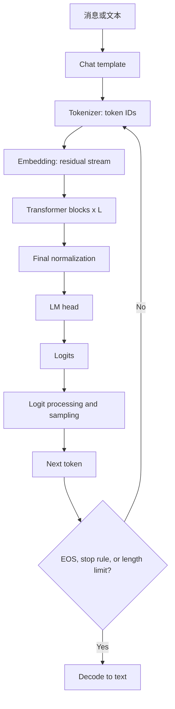
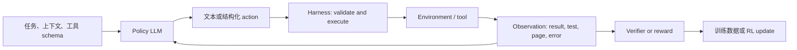

## 前言

本文以现代自回归语言模型为对象，介绍其基础骨架 decoder-only Transformer，包括基础的前向计算、训练和推理的基本流程、长下文的处理、Agent 能力的训练等内容。

Decoder-only Transformer 的整体计算流程为：聊天模板的特殊 token 插入 $\rightarrow$ 分词 $\rightarrow$ 向量嵌入 $\rightarrow$ transformer 块计算 $\rightarrow$ 输出头 $\rightarrow$ 采样，如下图所示。


本文使用的主要记号如下表所示。

| 符号               | 含义                               |
| ---------------- | -------------------------------- |
| $B$              | 本批请求或样本数                         |
| $T$              | 本次张量的实际序列长度，不等于最大上下文窗口           |
| $T_{max}$        | 模型允许的最大上下文长度                     |
| $d$、$L$、$V$      | 隐藏维度、层数、词表大小                     |
| $h_q,h_{kv},d_h$ | query head 数、KV head 数、单 head 维度 |
## 1. 基础前向计算

### Tokenizer、embedding 与 residual stream

`Chat template` 将 system、user、assistant、tool 等消息边界编码成文本和特殊 token。Tokenizer 将文本变为整数 ID：

```text
messages → template text → subword tokens → input_ids [B, T]
```

输入 embedding 是查表：

$$
X^{(0)}=E[\mathrm{input\_ids}],\qquad E\in\mathbb{R}^{V\times d}.
$$

所得 $X^{(0)}\in\mathbb{R}^{B\times T\times d}$ 是贯穿网络的 **residual stream**。各子层只向它写入增量，主干维度始终为 $d$。

常见 tokenizer：

- **BPE**：从字符或字节单元开始，反复合并最高频相邻 pair。字节级 BPE 能可逆地表示任意 UTF-8 文本。
- **Unigram / SentencePiece**：从候选子词集合剪枝；编码时用动态规划选择概率最高的切分。[SentencePiece](https://arxiv.org/abs/1808.06226) 可直接训练原始文本，不依赖空格分词。

### Transformer block、normalization 与 residual

现代 LLM 常用 Pre-Norm（在注意力计算和 MLP 层之前而不是之后做归一化）：

$$
U^{(l)}=X^{(l)}+\operatorname{Attn}(\operatorname{RMSNorm}(X^{(l)})),
$$

$$
X^{(l+1)}=U^{(l)}+\operatorname{MLP}(\operatorname{RMSNorm}(U^{(l)})).
$$

Attention 在序列维度混合信息；MLP 对每一个 token 独立、以相同参数处理隐藏维度。第 $l$ 层的参数在所有 token position 间共享，不同层不共享。

对单个 token 的 $x\in\mathbb{R}^d$：

$$
\operatorname{LayerNorm}(x)=\gamma\odot\frac{x-\mu(x)}{\sqrt{\sigma^2(x)+\epsilon}}+\beta,
$$

$$
\operatorname{RMSNorm}(x)=g\odot\frac{x}{\sqrt{\frac{1}{d}\sum_i x_i^2+\epsilon}}.
$$
下表对比了 LayerNorm 和 [RMSNorm](https://arxiv.org/abs/1910.07467) 的主要区别：

| 性质 | LayerNorm | RMSNorm |
|---|---|---|
| 去均值 | 是 | 否 |
| 重新缩放 | 是 | 是 |
| 常见仿射参数 | scale、bias | 通常仅 scale |

与 LayerNorm 相比，RMSNorm 省去重中心化，保留激活尺度控制。后者与 Pre-Norm residual 组合后在大规模 LLM 中具有良好的训练稳定性和实现效率；这是一项经验性架构选择。

### Causal self-attention 与 GQA

令 $\bar X=\operatorname{RMSNorm}(X)$：

$$
Q=\bar XW_Q,\qquad K=\bar XW_K,\qquad V=\bar XW_V.
$$

$$
A=\operatorname{softmax}\left(\frac{QK^\top}{\sqrt{d_h}}+M\right),\qquad O=AV.
$$

因果 mask 为：

$$
M_{ij}=\begin{cases}
0,&j\le i\\
-\infty,&j>i.
\end{cases}
$$

它保证位置 $i$ 只读取自身及左侧 token。多头输出拼接后通过 $W_O$ 投回 $d$ 维（参见[Attention Is All You Need](https://arxiv.org/abs/1706.03762)）。

GQA 使用 $h_{kv}<h_q$，令多组 query heads 共享一组 K/V。它主要减少 decode 时 KV cache 的容量和带宽，不改变因果约束。

### SwiGLU MLP

令一个 token 的输入为列向量 $x\in\mathbb{R}^d$，中间维度为 $d_{ff}$：

$$
W_{gate},W_{up}\in\mathbb{R}^{d_{ff}\times d},\qquad W_{down}\in\mathbb{R}^{d\times d_{ff}}.
$$

$$
\operatorname{SwiGLU}(x)=W_{down}(\operatorname{SiLU}(W_{gate}x)\odot W_{up}x),
$$

$$
\operatorname{SiLU}(z)=z\sigma(z)=\frac{z}{1+e^{-z}}.
$$

`gate` 分支控制各中间特征通过的程度，`up` 分支提供内容。bias 是否存在属于模型配置；LLaMA 风格模型常关闭线性层 bias。为保持与 $d_{ff}=4d$ 的两层 ReLU FFN 相近参数量，SwiGLU 常取 $d_{ff}\approx\frac{8}{3}d$。SwiGLU 是经实验验证的 GLU 变体（参见[GLU Variants Improve Transformer](https://arxiv.org/abs/2002.05202)）。

### LM Head、logits 与采样

#### LM Head

LM head 实际上是对 $X^{(L)}$ 做 RMS 归一化后的一个线性层：
$$
H=\operatorname{RMSNorm}(X^{(L)}),\qquad Z=HW_{lm}+b_{lm}.
$$

$Z\in\mathbb{R}^{B\times T\times V}$ 是 logits。LM Head 在所有 token position 间共享。有些模型让 LM Head 与输入 embedding 共享参数：
$$W_{\text{lm}}=E^\top,$$
这被称为 weight tying。

#### Logits

推理时通常只使用最后一个位置的 logits $z=Z[:,-1,:]$。在采样前会对 logits 做规则性修改（统称 logit processing），例如：

* 禁止 token：把不允许生成的 token 的 logit 设为 $-\infty$，softmax 后概率就是 0。
  - 例如禁止生成某些控制符、已生成的 EOS 之后的内容，或 JSON 模式下禁止不合法字符。

* repetition penalty：降低已经出现过的 token 再次被选中的倾向，减少“好的好的好的”或反复输出同一句。
  - 常见实现会对已出现 token 的 logit 做缩放或扣分。
  - 过强会损害代码、专有名词和正常重复表达。

* frequency penalty：token 出现次数越多，惩罚越大。
  - 适合抑制高频重复。

* presence penalty：只要 token 曾出现过就惩罚一次，不随次数继续累积。
  - 更倾向于让模型引入新词、新话题。

在 logit processing 之后一般还会使用 temperature、top-k、top-p 等采样策略调整概率分布：

* temperature $\tau$：将 logits 除以 $\tau$，$0<\tau<1$ 更集中，$\tau>1$ 更随机；$\tau\to0$ 通常直接走 greedy argmax；允许的 temperature 范围由推理 API 定义，常见接口可能是 `0–2`、`0–1` 或预设值。

* top-k：保留最大 logits 的 $k$ 个 token，其余 tokens 的 logits 设为 $-\infty$.

* top-p：保留累计 softmax 概率首次达到 $p$ 的最小 token 集合，再重新归一化。

常见的处理流程是：
```text
原始 logits
→ 禁止 token / repetition / frequency / presence 等规则
→ temperature
→ top-k / top-p 截断
→ 对保留集合重新归一化
→ 采样 或 argmax
```
#### 采样

Logit 处理完成后计算最终的概率分布 $p_i=\operatorname{softmax}(z_i/\tau)$，从该分布中随机采样：
$$
x_{t+1} \sim p(\cdot | x_{\le t})
$$
得到新 token 后，追加 token 到序列，再送入模型，得到下一组 logits，继续采样，直到
* 生成 `EOS`；
* 达到最大 token 数；
* 命中 `stop sequence`；
* 或被外部系统终止。

注意，`EOS` 是词表中、在训练时见过的结束 token；`stop sequence` 是客户端/API 的外部字符串终止规则。

## 2. 训练、prefill 与 decode

训练和推理（推理又分为 Prefill 和 Decode 两个阶段）的输入输出差异见下表：

| 阶段      |             输入 |     query 长度 | 输出用途                   | KV cache |
| ------- | -------------: | -----------: | ---------------------- | -------- |
| 训练      | 完整 token block |          $T$ | 所有位置计算 next-token loss | 通常不保留    |
| Prefill |      完整 prompt | $T_{prompt}$ | 最后位置 logits 生成首 token  | 为每层建立    |
| Decode  |     最新生成 token |            1 | 采样下一个 token            | 读取并追加    |

训练用 shifted labels：

```text
输入： [x0, x1, x2, ..., x(T-2)]
标签： [x1, x2, x3, ..., x(T-1)]
```

$$
\mathcal L_{LM}=-\sum_t\log p_\theta(x_{t+1}\mid x_{\le t}).
$$
所有位置并行计算，但 causal mask 阻止标签泄漏。

### Prefill 与 decode 的掩码

Prefill 一次输入完整 prompt，位置 $i$ 仍不能读取 prompt 中 $i+1$ 及后续 token；否则进入 KV cache 的表示已经泄漏未来信息。因此 prefill 必须使用 causal mask，通常由 attention kernel 隐式实现。

单 token decode 时：

$$
Q_{new}\in\mathbb{R}^{B\times h_q\times1\times d_h},\qquad
K_{cache},V_{cache}\in\mathbb{R}^{B\times h_{kv}\times(t+1)\times d_h}.
$$

Cache 中没有未来 token 的 K/V，故该单 query 的 causal mask 在数学上冗余。未来 token 并非填成 0，而是尚未存在；为了 batch 对齐加入的 padding 必须被 padding mask 排除。Speculative decoding、chunked prefill 等一次处理多个新 token 的场景仍需因果约束。

### 不等长请求、KV cache 与训练 packing

`[B,T]` 里的 $T$ 是本次张量的实际长度或 padding 后长度，不是最大上下文长度 $T_{max}$：

$$
T_{prompt}+T_{reserved\ output}\le T_{max}.
$$

连续 batching 的调度器将多条请求的 prefill chunk 和 decode token 放入同一轮计算。Ragged/varlen attention 或 padding mask 跳过无效 token；paged KV cache 为每条请求维护独立的长度、position ID、KV blocks 和停止状态。

若文档长于 $T_{train}$，预训练常将其切为 token block；若样本短，则 sequence packing 填满 token budget。连续语料可用 EOS 串为一个 stream；独立指令样本可用 block-diagonal attention mask 隔离；指令微调通常只对 assistant token 计算 loss。短 block packing 提高吞吐，但不会提供跨块长期依赖的训练信号。

## 3. 长上下文：位置、训练长度与注意力系统

### 三个必须区分的概念

| 概念 | 含义 |
|---|---|
| 最大窗口 $T_{max}$ | 模型与服务接受的 token 上限 |
| 位置泛化 | 位置表示在训练长度外仍有合理定义 |
| 有效上下文能力 | 远位置信息能被检索、组合、推理和稳定使用 |

普通稠密 attention 的 prefill 计算随 $T^2$ 增长，KV cache 随 $T$ 增长。位置外推只能处理位置编号，不能单独解决计算、缓存与长程推理。

### RoPE 与外推

RoPE 将每个 attention head 两两配对。频率和位置 $m$ 的旋转为：

$$
\theta_i=\mathrm{base}^{-2i/d_h},
$$

$$
\begin{bmatrix}x'_{2i}\\x'_{2i+1}\end{bmatrix}
=
\begin{bmatrix}
\cos(m\theta_i)&-\sin(m\theta_i)\\
\sin(m\theta_i)&\cos(m\theta_i)
\end{bmatrix}
\begin{bmatrix}x_{2i}\\x_{2i+1}\end{bmatrix}.
$$

应用于 Q/K 后：

$$
(q_m')^\top k_n'=q_m^\top R_{n-m}k_n,
$$

注意力点积因而含有相对距离 $n-m$，参见 [RoFormer](https://arxiv.org/abs/2104.09864)。

Position Interpolation、NTK-aware scaling、[YaRN](https://arxiv.org/abs/2309.00071) 等通过修改位置/频率映射来扩展既有 RoPE 模型的窗口，通常还需长序列 continued training。

### DeepSeek-V4：1M 的训练和架构路径

DeepSeek-V4 技术报告披露的训练序列长度是：

```text
4K → 16K → 64K → 1M
```

前 $1T$ token 使用 dense-attention warmup；到 $64K$ 时引入 sparse attention，并单独 warm up CSA lightning indexer；后续阶段使用 CSA/HCA 混合注意力训练至 $1M$ 序列长度。

因此，V4 的 $1M$ 由最终训练阶段的 $T_{train}=1M$、partial RoPE 和长上下文注意力结构共同获得，不是仅在短训练窗口上进行纯推理 RoPE 外推。公开配置也将 `max_position_embeddings` 设为 1,048,576。

V4 的长程注意力由三条通路组成：

- **CSA**：每 $m=4$ 个 token 压为一个 KV entry；indexer 在压缩条目中选 top-$k$，Flash 为 512、Pro 为 1024。
- **HCA**：每 $m'=128$ 个 token 压为一个更粗粒度 entry，并在全部压缩 entry 上计算注意力。
- **local branch**：保留最近 128 个未压缩 KV，补充局部细节。

CSA/HCA 对 query/KV entry 的最后 64 维使用 partial RoPE；core attention 输出的对应维度再施加位置 $-i$ 的旋转，保持相对位置关系。它同时解决训练长度、位置表示、远程 KV 压缩和计算成本问题。具体可参考 [DeepSeek-V4 技术报告](https://huggingface.co/papers/2606.19348) 和 [V4 架构实现说明](https://huggingface.co/docs/transformers/v5.12.0/model_doc/deepseek_v4)。

### 2026 年公开模型的序列机制

| 模型 | 公开的序列机制 | RoPE 状态 | 上下文信息 |
|---|---|---|---|
| DeepSeek-V4 | CSA/HCA、MQA、sliding window、KV 压缩和稀疏 indexer | partial RoPE | 原生 1M；训练长度渐进升至 1M |
| Kimi K3 | 69 个 KDA 层与 24 个 Gated MLA 层交错，Attention Residuals | 配置含 `mla_use_nope=true`，但保留 64 维 `qk_rope_head_dim` | 公开配置为 1M；训练长度 curriculum 未披露 |
| Qwen3.8-2.4T-A95B | 每 3 个 Gated DeltaNet 线性层插入 1 个 Gated Attention 层 | 全注意力层仅 $64/256$ head 维度使用 partial RoPE | 原生 262,144，模型卡称可扩展至约 1.01M |

Kimi K3 的 KDA 与 Qwen3.8 的 Gated DeltaNet 都通过顺序状态更新和局部卷积等线性注意力机制承载序列顺序，避免每层对全部历史存储标准全注意力 KV。两者仍保留部分全注意力/MLA 层，线性注意力不等于模型完全没有 RoPE。

资料：[Kimi K3 配置](https://huggingface.co/moonshotai/Kimi-K3/raw/main/config.json)、[Kimi K3 模型卡](https://huggingface.co/moonshotai/Kimi-K3/raw/main/README.md)、[Qwen3.8 模型卡](https://huggingface.co/Qwen/Qwen3.8-2.4T-A95B)、[Qwen3.8 配置](https://huggingface.co/Qwen/Qwen3.8-2.4T-A95B/raw/main/config.json)。

### 主流的非全量 RoPE 路线

| 路线 | 顺序/位置机制 | 代表模型 | 主要收益 |
|---|---|---|---|
| Partial RoPE + 压缩/稀疏 attention | 仅旋转部分维度；远处经压缩 KV entry 访问 | DeepSeek-V4 | 缩小远程 cache 和读取量，保留相对位置通路 |
| Linear / recurrent attention | token 顺序更新有限大小的状态 | Kimi K3 的 KDA、Qwen3.8 的 Gated DeltaNet | 状态不随完整历史线性增长 |
| Hybrid linear attention + partial-RoPE full attention | 大多数层走状态通路，周期性插入全注意力层 | Qwen3.8 | 兼顾长序列效率和选择性全局检索 |

长上下文 Agent 不能只依赖 $T_{max}$。训练需要长序列 curriculum、带环境反馈的多步轨迹和可验证评测；系统仍需要检索、摘要、外部状态、checkpoint 与上下文预算。

## 4. Agent 能力的训练

### 学习对象：带环境反馈的策略



Agent 的模型部分学习策略 $\pi_\theta(a_t\mid s_t)$：在状态 $s_t$ 输出文本 token 或结构化动作 $a_t$。Harness 执行 schema 校验、权限控制、工具调用、超时、重试和终止；工具不在模型内部执行。

### Trajectory SFT

一条轨迹可编码为：

```text
user task
assistant: plan / tool_call(name, arguments)
tool: observation
assistant: next tool_call(...)
tool: observation
assistant: final answer
```

对需学习的 assistant token 设 $m_t=1$，对 user/tool observation 设 $m_t=0$：

$$
\mathcal L_{agent\text{-}SFT}=-\sum_t m_t\log p_\theta(y_t\mid y_{<t},x).
$$

可用数据包括人工示范、可执行工作流、强教师模型成功轨迹、程序合成任务，以及失败轨迹的修复版本。每条数据需保留工具 schema、真实 observation 与执行环境版本，保证部署环境可复现。

### Reward、偏好优化与在线 RL

| 信号 | 示例 | 作用 |
|---|---|---|
| Outcome reward | 单元测试通过、答案和引用一致、数据库状态正确 | 优化最终交付 |
| Process reward | 工具参数有效、引用定位正确、中间状态满足约束 | 缓解长轨迹稀疏奖励 |
| Preference pair | 成功轨迹优于失败、低成本轨迹优于高成本轨迹 | 离线 DPO 等偏好优化 |
| Constraint penalty | 越权调用、死循环、超时、预算超标 | 安全与资源控制 |

离线偏好优化直接使用优/劣轨迹对。在线 RL 从当前策略 rollout 完整轨迹，优化目标可表示为：

$$
J(\theta)=\mathbb{E}_{\tau\sim\pi_\theta}
\left[R_{outcome}(\tau)+\sum_t r_{step}(s_t,a_t)-\beta\,\mathrm{KL}(\pi_\theta\|\pi_{ref})\right].
$$

PPO、GRPO 等是策略优化的不同实现。长轨迹若仅在结束时给奖励，会出现信用分配困难；过程 verifier、分段奖励、失败定位和难度 curriculum 用于补足早期动作的训练信号。

### 典型后训练阶段与评测

```text
通用预训练
  → 指令和工具格式 SFT
  → 专项能力训练（代码、检索、浏览、GUI、数据分析）
  → 可执行环境 rollout
  → verifier/reward 驱动的 RL 或偏好优化
  → 失败轨迹挖掘、修复与再训练
  → 统一蒸馏与评测
```

训练通常从单工具确定性任务扩展到多工具组合、含错误反馈的重试任务和长时程任务。评测同时报告任务成功率、工具参数有效率、步骤数、时间、token/费用、引用正确性、安全违规率与中断恢复能力。

DeepSeek-V4 公开材料披露后训练中 specialist 的 SFT/RL 和 on-policy distillation 的能力统一阶段，但没有公开足以精确复现其 tool-use reward、teacher/student 损失或环境配置的细节，见[DeepSeek-V4 模型卡](https://fe-static.deepseek.com/chat/transparency/deepseek-V4-model-card-EN.pdf)。

## 5. 链路和技术点总结

```text
文本 → tokenizer → IDs → embedding / residual stream
→ [norm → attention / position mechanism → residual add
   → norm → MLP or MoE → residual add] × L
→ final norm → LM head → logits → sampling → next token

训练：完整 block 并行、causal mask、shifted labels、cross-entropy
prefill：完整 prompt、causal attention、建立 KV cache
decode：每步一个 token、读取并追加 KV cache
长上下文：位置泛化 + 长序列训练 + attention/KV 系统 + 长程评测
agent：trajectory SFT + 环境 rollout + verifier/reward + preference/RL + harness
```

## 6. 重要参考资料

- Vaswani et al., [Attention Is All You Need](https://arxiv.org/abs/1706.03762)
- Su et al., [RoFormer: Rotary Position Embedding](https://arxiv.org/abs/2104.09864)
- Peng et al., [YaRN: Efficient Context Window Extension](https://arxiv.org/abs/2309.00071)
- Zhang and Sennrich, [Root Mean Square Layer Normalization](https://arxiv.org/abs/1910.07467)
- Shazeer, [GLU Variants Improve Transformer](https://arxiv.org/abs/2002.05202)
- Kudo and Richardson, [SentencePiece](https://arxiv.org/abs/1808.06226)
- DeepSeek, [V4 技术报告](https://huggingface.co/papers/2606.19348) 与 [官方模型卡](https://fe-static.deepseek.com/chat/transparency/deepseek-V4-model-card-EN.pdf)
- Moonshot AI, [Kimi K3 模型卡与技术报告入口](https://huggingface.co/moonshotai/Kimi-K3)
- Qwen, [Qwen3.8-2.4T-A95B 模型卡](https://huggingface.co/Qwen/Qwen3.8-2.4T-A95B)
