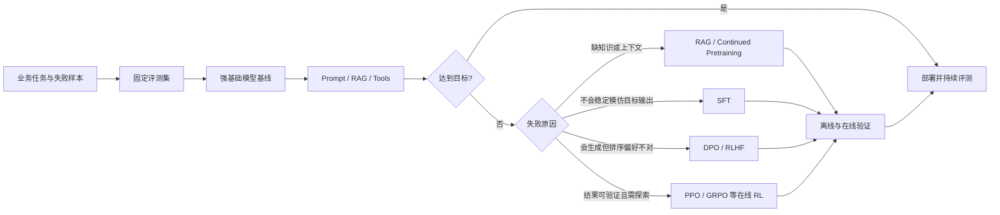
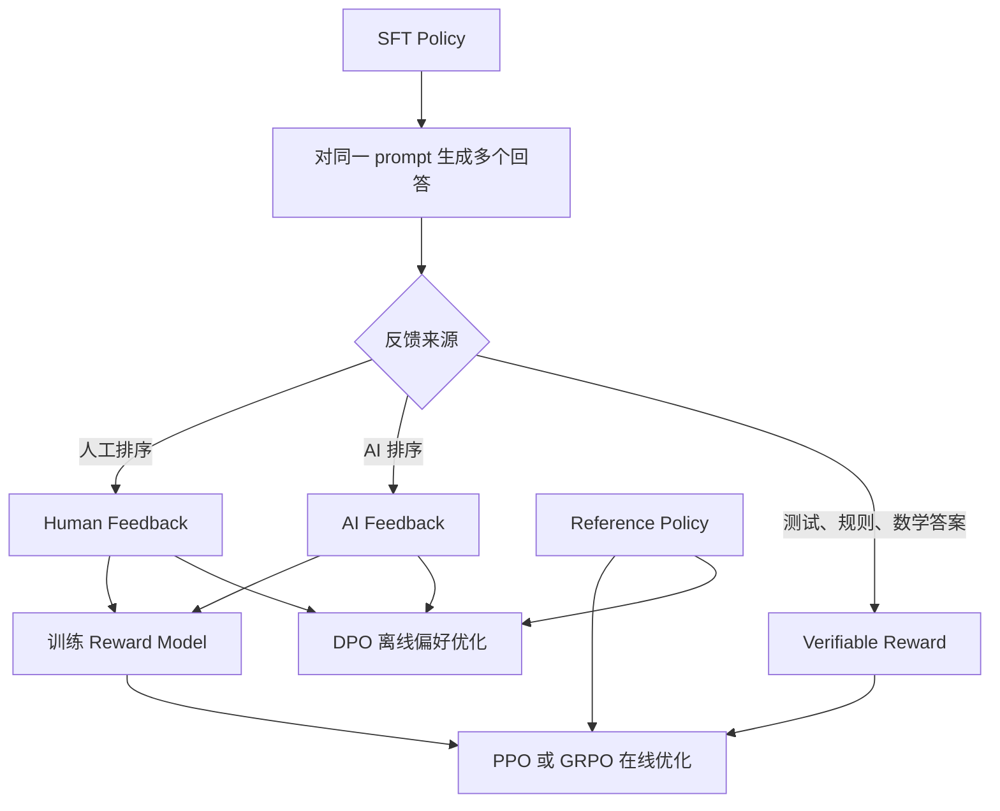

## 前言

基础模型的指令遵循、推理和长上下文能力越来越强，许多任务只靠 prompt、few-shot 示例、RAG 和工具调用就能完成。微调仍有价值，但不应再作为所有 LLM 应用的默认起点。只有当任务分布稳定、行为目标明确、数据与评测闭环成熟时，参数更新才可能换来更高的成功率、更稳定的输出或更低的推理成本。

本文讨论四个问题：强基础模型时代微调还有什么价值；SFT、RLHF、PPO、DPO 和 GRPO 分别优化什么；什么时候应选择 prompt engineering、SFT 或偏好/RL 训练；工程上怎样判断一次微调是否真正产生收益。

完整的模型改进路径可以表示为：



## 1. 先区分几类“微调”

“微调”常被用于指代所有预训练后的参数更新，但不同阶段的数据、损失函数和目标并不相同。

| 方法 | 典型数据 | 直接优化的目标 | 主要用途 |
|---|---|---|---|
| Continued Pretraining，继续预训练 | 领域原始文本、代码、日志 | next-token likelihood | 学习领域语言、知识与分布 |
| SFT，监督微调 | 指令与理想回答 $(x,y)$ | 模仿目标回答 token | 教格式、任务流程和行为模式 |
| Reward Model，奖励模型 | 同一输入下的回答排序 | 预测人类或规则偏好 | 把偏好变成可优化的标量 |
| PPO / GRPO 等在线 RL | 当前策略 rollout 与奖励 | 最大化期望奖励并限制策略漂移 | 让模型通过探索发现高奖励行为 |
| DPO 等离线偏好优化 | chosen/rejected 回答对 | 提高 chosen 相对概率 | 不显式训练 RM、不做在线 rollout 即可对齐偏好 |
| LoRA / QLoRA | 与上述任一目标配合 | 改变参数更新方式 | 降低显存、存储和多任务适配成本 |

LoRA 不是与 SFT、DPO 并列的训练目标。SFT 描述“学什么”，LoRA 描述“更新哪些参数、如何表示更新”；因此可以进行 LoRA-SFT，也可以进行 LoRA-DPO。

工程上还应区分 base model 与 instruct/chat model。Base model 主要接受 next-token 预训练，未必能稳定理解对话模板；instruct model 已经做过 SFT 和偏好训练。业务团队通常从能力足够的 instruct model 开始，而不是重新把 base model 训练成助手。

## 2. 基础模型越来越强，微调还有价值吗？

### 2.1 结论：有价值，但需要更高的立项门槛

强模型扩大了 prompt 能解决的问题范围，也提高了微调必须击败的基线。是否立项，取决于下面这个判断：

> 在固定任务分布上，参数更新带来的质量、成本或稳定性收益，能否覆盖数据、训练、评测、部署和回归风险？

微调较有价值的场景包括：

- 输出协议非常严格，需要长期稳定地产生固定 JSON、DSL、标签或工具参数。DSL（Domain-Specific Language，领域特定语言）是为某一类任务设计的小型语言，例如 SQL、正则表达式或公司内部的工作流指令；
- 任务高频且分布相对稳定，few-shot prompt 很长，SFT 后可以减少示例和输入 token；
- 企业存在大量高质量示范、偏好对或可执行 verifier，能形成持续的数据闭环；
- 小模型经过专项训练后可以替代昂贵的大模型，在目标任务上降低延迟和单次成本；
- 需要学习组织特有的决策边界、语气、拒答规则或多步工作流，而这些规则很难在每次 prompt 中完整表达；
- 需要 on-premise 部署，即把模型和推理服务运行在企业自己的机房、私有云或受控网络内，而不是调用外部厂商的托管 API；或者需要离线运行、固定权重版本，并且基础模型本身允许训练和分发衍生权重。

微调价值较低或风险较高的场景包括：

- 需求仍在频繁变化，今天训练的目标下周就会改变；
- 主要问题是缺少实时事实、私有文档或精确来源，此时应优先使用 RAG、数据库或工具；
- 只有几十条未经验证的样本，且没有独立测试集；
- 强模型加清晰 prompt 已达到业务目标；
- 任务失败源于上游解析、检索、权限、工具执行或系统状态，而不是模型行为；
- 无法定义比训练 loss 更接近业务价值的评测指标。

### 2.2 微调更擅长改变行为，不擅长充当数据库

SFT 很适合学习“看到这种输入时怎样回答”，例如输出 schema、分类边界、代码补丁风格和工具调用顺序。把不断变化的商品价格、规章版本或内部文档硬写进参数，通常不如检索系统：参数知识难以定位来源、局部更新和删除，也容易与预训练知识冲突。

可以用下面的经验法则判断：

```text
需要模型知道最新事实           → RAG / Search / Database / Tool
需要模型遵循稳定的输出示范      → SFT
需要模型在多个可行回答中偏爱某类 → DPO / RLHF
需要模型通过尝试发现解题策略     → 在线 RL（PPO / GRPO 等）
需要模型适应领域语言分布         → Continued Pretraining，再做 SFT
```

### 2.3 强模型也改变了数据策略

基础能力增强后，低质量大数据集的边际价值下降，任务覆盖和标签正确性更加重要。微调数据不应只是把现有 prompt 批量生成一遍；否则 student 主要复现 teacher 的平均行为，错误也会被固化。更有价值的数据往往来自真实失败样本、边界条件、对抗样本、专家修正和可执行环境中的成功轨迹。

## 3. SFT：用最大似然模仿理想回答

给定输入 $x$ 和目标回答 $y=(y_1,\ldots,y_T)$，SFT 的 token-level cross-entropy 为：

$$
\mathcal L_{SFT}(\theta)
=-\sum_{t=1}^{T}m_t\log\pi_\theta(y_t\mid x,y_{<t}).
$$

$m_t$ 是 loss mask。对话训练通常只让 assistant 的目标 token 参与 loss，而 user、system、tool observation 和 padding token 只作为条件。训练使用 teacher forcing：预测第 $t$ 个 token 时，前缀来自标准答案，而不是模型自己先前生成的 token。

SFT 本质上是行为克隆。它的优势是稳定、便宜、容易调试；限制是只能提高数据中行为的概率，难以探索数据之外更好的策略。对一个有多种正确写法的问题，单一参考答案还可能惩罚其他合理输出。

### 3.1 数据比 epoch 更重要

一条可用的 SFT 样本至少应保证：

- chat template 与部署时一致；
- system、user、assistant 和 tool 角色边界正确；
- 答案确实优于当前模型输出，而不是只有不同措辞；
- 难例和普通流量的比例与训练目标匹配；
- 相同用户、文档、代码仓库或模板不会跨 train/test 泄漏；
- 长度分布、语言、领域和输出格式覆盖线上流量。

重复训练过多会使模型记住局部措辞、降低输出多样性，甚至破坏通用能力。应同时观察训练 loss、验证 loss、目标任务指标与通用回归集，而不是以 loss 持续下降作为成功标准。

## 4. 反馈驱动的后训练：RLHF、PPO、DPO 与 GRPO

RLHF、PPO、DPO 和 GRPO 不在同一概念层级。RLHF 描述训练信号来自哪里以及整条训练流程如何组织；PPO 和 GRPO 是可以放进这条流程的强化学习优化算法；DPO 直接使用偏好对训练模型，不运行在线强化学习。

更准确的关系如下：



| 路线 | 反馈 | 是否在线采样 | 是否属于强化学习 | 常见称呼 |
|---|---|---:|---:|---|
| 人类偏好训练 RM，再用 PPO 或 GRPO 更新策略 | 人类比较 | 是 | 是 | RLHF |
| AI 偏好训练 RM，再做策略优化 | AI 比较 | 是 | 是 | RLAIF |
| 单元测试、编译器或数学答案直接给奖励 | 可验证结果 | 是 | 是 | RLVR |
| 用人类或 AI 偏好对直接训练 policy | chosen/rejected 对 | 否 | 严格说不是 | DPO / offline preference optimization |

因此，PPO 可以是经典 RLHF 的最后一个阶段，GRPO 可以替换其中的 PPO。DPO 与 RLHF 使用相似的偏好数据，也能从同一个 KL-regularized reward objective 推导出来，但它没有环境 rollout、critic，也不使用基于 rollout reward 的 policy-gradient estimator。工程讨论中常把 DPO 放在广义“RLHF/对齐”体系内；从算法定义看，把它称为强化学习算法并不准确。本节使用“反馈驱动的后训练”作为上位概念。

### 4.1 经典 RLHF 流程与奖励模型

Reinforcement Learning from Human Feedback（RLHF，人类反馈强化学习）不是某一个优化器。经典 InstructGPT 流程包含三个阶段：

1. 用示范数据做 SFT，得到能够基本遵循指令的初始策略。
2. 对同一 prompt 生成多个回答，由标注者比较优劣，再用这些比较训练 Reward Model（RM，奖励模型）。
3. 把 RM 当作奖励函数，用 PPO 等强化学习算法更新策略，同时限制新策略偏离 SFT reference policy。

对同一个 prompt $x$，设标注者认为回答 $y_w$ 优于 $y_l$。奖励模型 $r_\phi(x,y)\in\mathbb R$ 为完整回答输出一个标量。Bradley-Terry 模型定义偏好概率为：

$$
P(y_w\succ y_l\mid x)
=\sigma\left(r_\phi(x,y_w)-r_\phi(x,y_l)\right),
$$

其中 $\sigma(z)=1/(1+e^{-z})$。在比较样本相互独立、每条样本包含一个 chosen/rejected 对的设定下，负对数似然损失为：

$$
\mathcal L_{RM}(\phi)
=-\mathbb E_{(x,y_w,y_l)}
\log\sigma\left(r_\phi(x,y_w)-r_\phi(x,y_l)\right).
$$

RM 拟合的是给定标注规范和采样分布下的偏好，不能视为客观质量函数。训练样本若只覆盖短回答，策略可能通过增加长度、堆叠格式或迎合 judge 获得高分。这类对代理目标的利用称为 reward hacking。

### 4.2 Policy Gradient：怎样从一个总分训练每个 token

Policy Gradient（策略梯度）是一类直接优化随机策略 $\pi_\theta(a\mid s)$ 的强化学习方法。价值型方法通常先学习 $Q(s,a)$，再用 $\arg\max_a Q(s,a)$ 选动作；策略梯度直接学习“在状态 $s$ 下怎样分配动作概率”。这里的 policy 就是语言模型：给定当前上下文，它为词表中的下一个 token 分配概率。策略梯度要解决的问题是，模型生成完一段回答后只得到一个分数，怎样把这个分数转化为模型参数的梯度。

#### 先把文本生成写成强化学习问题

设 prompt $x$ 从训练分布 $\mathcal D$ 中采样。LLM 逐 token 生成回答时，各个对象的含义如下。

| 记号 | 定义 |
|---|---|
| $\mathcal V$ | 模型的有限词表，即动作空间 |
| $s_t=(x,a_1,\ldots,a_{t-1})$ | 生成第 $t$ 个 token 前的状态，由 prompt 和已有回答前缀组成 |
| $a_t\in\mathcal V$ | 第 $t$ 个动作，即采样出的 token |
| $\pi_\theta(a_t\mid s_t)$ | 参数为 $\theta$ 的模型在状态 $s_t$ 选择 token $a_t$ 的概率 |
| $r_t\in\mathbb R$ | 执行 $a_t$ 后得到的即时奖励 |
| $T$ | 本条回答的结束位置；生成 EOS 或达到长度上限时终止 |
| $\tau=(s_1,a_1,r_1,\ldots,s_T,a_T,r_T)$ | 一次完整生成轨迹 |
| $\gamma\in[0,1]$ | 折扣因子，控制较远奖励的权重 |

在普通文本生成中，状态转移很简单：选出 $a_t$ 后，把它追加到前缀中就得到 $s_{t+1}$。只要采样规则和工具环境固定，依赖模型参数 $\theta$ 的部分主要是 token 概率 $\pi_\theta(a_t\mid s_t)$。

下面的基础策略梯度推导还假设 prompt 分布、状态转移和奖励计算不直接依赖 $\theta$。这里的“不直接依赖”是指：固定已经实现的 prompt 和轨迹后，改变 $\theta$ 不会改变这条轨迹的奖励；$\theta$ 仍会通过轨迹分布间接影响平均回报。交换积分与求导所需的正则条件将在推导处明确给出。若目标中含有 current-policy KL 这类显式依赖 $\theta$ 的正则项，需要单独计算其梯度，或者像 PPO rollout 那样先用 old policy 把本批 reward 固定下来。

轨迹的总回报定义为：

$$
R(\tau)=\sum_{t=1}^{T}\gamma^{t-1}r_t.
$$

从时刻 $t$ 开始观察到的 reward-to-go 定义为：

$$
G_t=\sum_{k=t}^{T}\gamma^{k-t}r_k.
$$

两者的区别只是起点不同。$R(\tau)$ 评价整条回答，$G_t$ 只计算动作 $a_t$ 之后还能获得的奖励。由定义可得 $R(\tau)=G_1$。

例如，一条三步轨迹的即时奖励为 $(r_1,r_2,r_3)=(0,0,1)$，折扣因子为 $\gamma=0.9$，则：

$$
R(\tau)=G_1=0.9^2=0.81,
\qquad
G_2=0.9,
\qquad
G_3=1.
$$

越早的动作离最终奖励越远，折扣后的 reward-to-go 越小。

LLM 后训练通常是有限长度的 episodic task，很多实现取 $\gamma=1$。如果奖励模型只在回答结束时给出 $R_{final}$，即 $r_t=0$ 对所有 $t<T$ 成立且 $r_T=R_{final}$，那么：

$$
R(\tau)=G_1=G_2=\cdots=G_T=R_{final}.
$$

这正是信用分配困难的来源：只看原始 return 时，回答里的每个 token 都拿到同一个最终分数。模型知道整段回答好或坏，却不知道哪几个 token 起了决定作用。

策略的训练目标是让平均总回报尽量高：

$$
J(\theta)=
\mathbb E_{x\sim\mathcal D}
\mathbb E_{\tau\sim p_\theta(\cdot\mid x)}
[R(\tau)].
$$

$p_\theta(\tau\mid x)$ 是给定 prompt 时生成整条轨迹的概率。对纯文本生成，忽略与 $\theta$ 无关的确定性状态转移项后，有：

$$
p_\theta(\tau\mid x)
=\prod_{t=1}^{T}\pi_\theta(a_t\mid s_t).
$$

#### 为什么不能直接对最终分数反向传播

奖励模型、单元测试或人工评分通常只接收已经生成的完整回答。中间的 token 采样是离散操作，奖励函数本身也可能不可微。例如，编译成功记为 $1$、失败记为 $0$，无法像 cross-entropy 那样直接从这个判断一路求导到每个 token 的 logits。

Policy Gradient 不要求对奖励函数求导。它改为求“生成这条轨迹的概率”对参数的导数。为同时保留 prompt 和轨迹的随机性，记 $\mathcal T_x$ 为给定 prompt $x$ 后所有可能的完整轨迹组成的轨迹空间；在有限长度的纯文本生成中，它就是所有可能的变长 token 序列及其对应状态、奖励所组成的集合。设 $\mu_x$ 是 $\mathcal T_x$ 上与 $\theta$ 无关的参考测度，$p_\theta(\tau\mid x)$ 是轨迹分布相对于 $\mu_x$ 的密度或概率质量函数。因此，$\int_{\mathcal T_x}\cdots\,\mu_x(\mathrm d\tau)$ 表示对给定 $x$ 后的全部可能轨迹积分；若轨迹空间是离散的，它就等于对 $\tau\in\mathcal T_x$ 求和。于是

$$
J(\theta)
=\int_{\mathcal X}\mathcal D(\mathrm dx)
\int_{\mathcal T_x}
R(\tau)p_\theta(\tau\mid x)\,\mu_x(\mathrm d\tau).
$$

下面给出一组足以把求导移入积分号的条件。对 $\theta$ 的每个坐标 $\theta_j$，要求：

1. $p_\theta(\tau\mid x)$ 在 $\theta$ 的某个邻域 $U$ 内对 $\theta_j$ 可微，且轨迹分布的支撑不随 $\theta$ 改变；
2. $R(\tau)$ 可测，并且不直接依赖 $\theta$；
3. 存在与 $\theta'\in U$ 无关的可积函数 $g_j(x,\tau)$，使得

$$
\left|
R(\tau)
\frac{\partial}{\partial\theta_j}
p_{\theta'}(\tau\mid x)
\right|
\le g_j(x,\tau),
\qquad
\int_{\mathcal X}\mathcal D(\mathrm dx)
\int_{\mathcal T_x}g_j(x,\tau)\,\mu_x(\mathrm d\tau)<\infty.
$$

此时可由支配收敛定理得到 Leibniz 积分求导公式。仅有“$R$ 有界”一般还不够，因为 $\nabla_\theta p_\theta$ 仍可能缺少可积的支配函数。在有限训练集、有限词表并设置统一最大生成长度的纯文本生成中，prompt 和 token 序列都只取有限多个值；若状态转移和奖励又是确定的，上面的积分就是有限求和，交换求导与求和不需要额外的支配条件。

在这些条件下，并在 $p_\theta(\tau\mid x)>0$ 的支撑上使用 log-derivative trick，有：

$$
\begin{aligned}
\nabla_\theta J(\theta)
&=\int_{\mathcal X}\mathcal D(\mathrm dx)
\int_{\mathcal T_x}R(\tau)
\nabla_\theta p_\theta(\tau\mid x)\,\mu_x(\mathrm d\tau)\\
&=\int_{\mathcal X}\mathcal D(\mathrm dx)
\int_{\mathcal T_x}R(\tau)p_\theta(\tau\mid x)
\nabla_\theta\log p_\theta(\tau\mid x)\,\mu_x(\mathrm d\tau)\\
&=\mathbb E_{x\sim\mathcal D}
\mathbb E_{\tau\sim p_\theta(\cdot\mid x)}
\left[
R(\tau)\nabla_\theta\log p_\theta(\tau\mid x)
\right].
\end{aligned}
$$

第二行使用了 log-derivative trick：

$$
\nabla_\theta p_\theta
=p_\theta\nabla_\theta\log p_\theta.
$$

再利用轨迹概率的乘积分解：

$$
\log p_\theta(\tau\mid x)
=\sum_{t=1}^{T}\log\pi_\theta(a_t\mid s_t),
$$

可以得到：

$$
\nabla_\theta J(\theta)
=\mathbb E_{x\sim\mathcal D}
\mathbb E_{\tau\sim p_\theta(\cdot\mid x)}\left[
\sum_{t=1}^{T}
\nabla_\theta\log\pi_\theta(a_t\mid s_t)R(\tau)
\right].
$$

这个式子已经可以训练：高分轨迹中的 token 会被提高概率，低分轨迹中的 token 会被降低概率。由于时刻 $t$ 的动作不可能改变已经发生的奖励 $r_1,\ldots,r_{t-1}$，可以去掉这些过去奖励。按照前文对折扣回报的定义，得到：

$$
\nabla_\theta J(\theta)
=\mathbb E_{x\sim\mathcal D}
\mathbb E_{\tau\sim p_\theta(\cdot\mid x)}\left[
\sum_{t=1}^{T}
\gamma^{t-1}
\nabla_\theta\log\pi_\theta(a_t\mid s_t)G_t
\right].
$$

$\gamma^{t-1}$ 来自 $R(\tau)$ 中相对于轨迹起点的折扣，$G_t$ 内的 $\gamma^{k-t}$ 则以时刻 $t$ 为新起点。LLM 后训练常取 $\gamma=1$，外层因子此时全部等于 $1$。这就是 REINFORCE estimator。实现时，单条轨迹的 policy loss 可写成：

$$
\mathcal L_{REINFORCE}(\theta)
=-\sum_{t=1}^{T}
\gamma^{t-1}
\log\pi_\theta(a_t\mid s_t)\operatorname{stopgrad}(G_t).
$$

最小化这个 loss 等价于沿估计的 $\nabla_\theta J$ 做梯度上升。在上述数学假设下，固定一条已采样轨迹后，$R(\tau)$ 和 $G_t$ 都不直接依赖 $\theta$，所以 $\operatorname{stopgrad}$ 在数学上是冗余的。这里仍把它写出来，是为了明确自动微分实现中的计算图边界：rollout 得到的奖励和 return 只作为样本权重，梯度只经过 $\log\pi_\theta$ 分支。若 $G_t$ 本来就是一个与模型计算图断开的数值，去掉 $\operatorname{stopgrad}$ 不会改变结果。

若 $G_t$ 的实现包含 current critic、current-policy KL 或其他仍与 $\theta$ 相连的量，$\operatorname{stopgrad}$ 就不再只是记号：它会删除这些量对 $\theta$ 的显式导数。PPO 通常用冻结的 $V_{old}$ 和 rollout 时固定的 reward 构造 advantage，再把它们视为常数；若确实要优化一个显式依赖 $\theta$ 的奖励或正则项，则其直接梯度必须另行计算，不能用 $\operatorname{stopgrad}$ 后的 REINFORCE surrogate 代替完整梯度。

#### 为什么朴素 REINFORCE 很不稳定

上式无偏不等于好用。它有三个直接问题。

第一，采样方差大。同一个 prompt 可以生成许多不同回答；同一个回答分数还可能受采样偶然性、奖励模型噪声和回答长度影响。有限 batch 算出的梯度方向会明显波动。

第二，任务难度混入了梯度。假设简单 prompt 的大多数回答都能拿到 $0.9$，困难 prompt 的最好回答也只能拿到 $0.3$。直接乘绝对回报会让简单样本中的普通 token 得到很强的正更新，而困难样本中相对优秀的 token 反而权重较小。

第三，末端奖励无法准确定位早期决策。若一段代码只因最后少了一个括号而测试失败，整段 token 都拿到低分；相反，一段答案碰巧猜对最终结果时，前面的错误推理也可能一起被提高概率。

Baseline 和 critic 主要处理前两个问题。长序列的精确信用分配仍然困难，过程奖励、分段 verifier 或更细的环境反馈可以提供帮助。

#### Baseline 为什么不改变平均梯度

可以从 $G_t$ 中减去一个只依赖状态、不依赖当前动作的 baseline $b(s_t)$：

$$
\nabla_\theta J(\theta)
=\mathbb E\left[
\sum_{t=1}^{T}
\gamma^{t-1}
\nabla_\theta\log\pi_\theta(a_t\mid s_t)
(G_t-b(s_t))
\right].
$$

这个修改没有改变期望梯度。对 LLM 的有限离散词表，在固定 $s_t$ 时：

$$
\begin{aligned}
&\mathbb E_{a_t\sim\pi_\theta(\cdot\mid s_t)}
\left[
\nabla_\theta\log\pi_\theta(a_t\mid s_t)b(s_t)
\right]\\
&=b(s_t)\sum_{a_t\in\mathcal V}
\pi_\theta(a_t\mid s_t)
\nabla_\theta\log\pi_\theta(a_t\mid s_t)\\
&=b(s_t)\sum_{a_t\in\mathcal V}
\nabla_\theta\pi_\theta(a_t\mid s_t)\\
&=b(s_t)\nabla_\theta
\sum_{a_t\in\mathcal V}\pi_\theta(a_t\mid s_t)\\
&=b(s_t)\nabla_\theta1=0.
\end{aligned}
$$

如果 baseline 还依赖 $a_t$，上面的等式一般不成立，可能改变期望梯度。因此，“baseline 不影响无偏性”的条件是它在给定状态后不能随当前采样动作变化。

#### Baseline 为什么能降低方差

记 score function 为：

$$
z_t=\nabla_\theta\log\pi_\theta(a_t\mid s_t).
$$

单步梯度估计量为 $g_t=z_t(G_t-b(s_t))$。Baseline 不改变它的条件期望，因此降低方差等价于降低条件二阶矩：

$$
\mathbb E\left[
\|g_t\|^2\mid s_t
\right]
=\mathbb E\left[
\|z_t\|^2(G_t-b(s_t))^2\mid s_t
\right].
$$

把右侧看成关于 $b(s_t)$ 的二次函数并求极小值，得到最优 baseline：

$$
b^*(s_t)=
\frac{
\mathbb E[\|z_t\|^2G_t\mid s_t]
}{
\mathbb E[\|z_t\|^2\mid s_t]
}.
$$

该式要求分母为正；若某个状态下 score function 恒为零，策略在该处没有可更新方向，baseline 取值也不影响梯度。

如果不同动作对应的 $\|z_t\|^2$ 相差不大，上式近似为：

$$
b^*(s_t)\approx
\mathbb E[G_t\mid s_t].
$$

它去掉的是当前状态的公共难度。例如，在一个很容易的 prompt 上，所有回答的分数都偏高；在一个很难的 prompt 上，分数整体偏低。减去各自状态下的平均回报后，更新依据变成“这个 token 比当前状态下的平均选择好多少”，简单题和困难题的绝对分数不再直接混在一起。

#### Value、Q、advantage 和 critic 的关系

对固定策略 $\pi$，状态价值函数和动作价值函数定义为：

$$
V^\pi(s_t)=\mathbb E_\pi[G_t\mid s_t],
$$

$$
Q^\pi(s_t,a_t)=\mathbb E_\pi[G_t\mid s_t,a_t].
$$

$V^\pi(s_t)$ 表示处在该前缀时，继续按策略 $\pi$ 生成通常能得到多少回报；$Q^\pi(s_t,a_t)$ 表示先选择指定 token $a_t$，之后再按 $\pi$ 生成时的期望回报。两者之差是 advantage：

$$
A^\pi(s_t,a_t)
=Q^\pi(s_t,a_t)-V^\pi(s_t).
$$

$A^\pi>0$ 表示这个 token 比当前状态下策略的平均选择更好，$A^\pi<0$ 表示更差。策略梯度可以写为：

$$
\nabla_\theta J(\theta)
=\mathbb E\left[
\sum_{t=1}^{T}
\gamma^{t-1}
\nabla_\theta\log\pi_\theta(a_t\mid s_t)
A^\pi(s_t,a_t)
\right].
$$

真实的 $V^\pi$ 和 $Q^\pi$ 都未知，需要从 rollout 估计。PPO 通常训练一个参数为 $\psi$ 的 value model $V_\psi(s_t)$ 去近似 $V^\pi(s_t)$，这个模型称为 critic；生成 token 的 policy 称为 actor。Actor 负责选择动作，critic 提供 baseline。Critic 即使不完美，只要能解释一部分状态难度，仍可能降低策略梯度方差。

### 4.3 PPO：为什么要限制一次策略更新

朴素策略梯度还有一个问题：一次过大的更新可能直接破坏策略。某批 rollout 中，一个 token 可能因为奖励噪声得到很大的正 advantage。若对同一批数据反复做梯度更新，这个 token 的概率可能从很小迅速升到接近 $1$。此时，训练数据来自旧策略，而正在优化的模型已经变成另一种分布；原先的梯度估计不再可靠。

Proximal Policy Optimization（PPO，近端策略优化）处理的正是这个问题。它仍然使用 policy gradient 和 advantage，但会比较新旧策略对同一动作给出的概率，并限制单批数据把策略推得过远。

#### On-policy 为什么限制了数据复用

On-policy 表示采样数据的策略与要优化的策略相同或足够接近。设一批回答由 $\pi_{\theta_{old}}$ 生成。训练开始时，当前策略 $\pi_\theta$ 与 old policy 相同；做过几步更新后，两者出现差异。

如果仍想用 old policy 的样本估计 current policy 下的期望，可以使用 importance ratio：

$$
\rho_t(\theta)=
\frac{\pi_\theta(a_t\mid s_t)}
{\pi_{\theta_{old}}(a_t\mid s_t)}.
$$

这个比值要求 current policy 的动作分布不超出 old policy 的支持集。标准 softmax 对未屏蔽 token 给出正概率，因此采到的 $a_t$ 通常满足条件；若训练使用 hard mask，新旧策略必须采用一致的合法动作集合。

当 $\rho_t=1$ 时，新旧策略对该 token 的概率相同；$\rho_t=1.5$ 表示 current policy 给该 token 的概率是采样时的 $1.5$ 倍；$\rho_t=0.5$ 表示降到一半。

记 $\hat A_t$ 为从 rollout 估计得到的 advantage。在固定 old-policy 状态分布、并把 $\hat A_t$ 视为常数的局部近似下，unclipped surrogate objective 为：

$$
L^{PG}(\theta)
=\mathbb E_{(s_t,a_t)\sim\pi_{\theta_{old}}}
[\rho_t(\theta)\hat A_t].
$$

概率比校正了“样本来自 old policy、目标却是 current policy”的动作概率差异。但它不能让旧数据永久有效，因为更新后连访问哪些状态的概率也会改变。对 LLM 而言，前面 token 的概率一旦变化，后续会出现的回答前缀也随之变化。PPO 只在策略变化较小的局部范围内复用一批 rollout，之后必须重新采样。

#### 为什么不直接优化 probability ratio

若 $\hat A_t>0$，最大化 $\rho_t\hat A_t$ 会不断提高该 token 的概率；若 $\hat A_t<0$，则会不断降低其概率。理论期望中的正负样本可以互相平衡，但有限 batch 的 advantage 有噪声，critic 也不准确。重复多个 epoch 后，某些 ratio 可能变得非常大或非常小，下一轮生成分布随之突变，性能可能骤降。

TRPO 用显式 KL trust region 约束新旧策略，并通过较复杂的二阶优化求解。PPO-Clip 采用一阶优化和截断目标，工程实现更简单。

#### PPO-Clip 的公式为什么写成 min

设 clipping 范围 $\epsilon\in(0,1)$，并定义：

$$
\operatorname{clip}(\rho,1-\epsilon,1+\epsilon)
=
\begin{cases}
1-\epsilon,&\rho<1-\epsilon,\\
\rho,&1-\epsilon\le\rho\le1+\epsilon,\\
1+\epsilon,&\rho>1+\epsilon.
\end{cases}
$$

PPO-Clip 最大化：

$$
L^{clip}(\theta)=
\mathbb E_t\left[
\min\left(
\rho_t(\theta)\hat A_t,
\operatorname{clip}(\rho_t(\theta),1-\epsilon,1+\epsilon)\hat A_t
\right)
\right].
$$

对单个 token，这个目标可按 advantage 的符号写成：

$$
L_t^{clip}=
\begin{cases}
\min(\rho_t,1+\epsilon)\hat A_t,&\hat A_t\ge0,\\
\max(\rho_t,1-\epsilon)\hat A_t,&\hat A_t<0.
\end{cases}
$$

当 $\hat A_t>0$ 时，该 token 比预期好，应该提高概率；但 $\rho_t$ 超过 $1+\epsilon$ 后，继续提高概率不会增加 clipped objective。当 $\hat A_t<0$ 时，该 token 比预期差，应该降低概率；但 $\rho_t$ 低于 $1-\epsilon$ 后，继续降低也不会增加目标。

假设 $\epsilon=0.2$。一个正 advantage token 的 ratio 从 $1.0$ 增至 $1.2$ 会提高目标，从 $1.2$ 增至 $1.5$ 则没有额外收益。一个负 advantage token 的 ratio 从 $1.0$ 降至 $0.8$ 会提高目标，从 $0.8$ 降至 $0.4$ 也没有额外收益。这使优化器缺少继续把已朝正确方向大幅移动的 token 推得更远的动力。

Clipping 不是把所有 ratio 强制限制在区间内。如果正 advantage token 的概率下降，或负 advantage token 的概率上升，目标仍会惩罚这种朝错误方向的变化。神经网络参数又被全部 token 共享，一个 token 的梯度可能连带改变其他 token。因此，工程实现还会监控新旧策略的实际 KL；超过阈值时，可以提前结束本批 update。

PPO 还有 penalty 变体，直接在 surrogate objective 中加入 current/old policy 的 KL penalty，并根据实际 KL 调整系数。PPO-Clip 更常见。这里的 current/old KL 用于限制单批更新，后面用于约束 RLHF 行为漂移的 reference KL 是另一项正则。

#### PPO 中的五个模型或快照

LLM RLHF 的 PPO 管线常出现多个模型，它们的职责不同：

| 对象 | 参数 | 是否训练 | 作用 |
|---|---|---:|---|
| Current policy / actor | $\pi_\theta$ | 是 | 正在更新的语言模型 |
| Old policy / behavior policy | $\pi_{\theta_{old}}$ | 每批冻结 | 生成当前 rollout，并提供旧 log-prob |
| Reference policy | $\pi_{ref}$ | 通常全程冻结 | 约束模型不要远离 SFT 起点 |
| Critic / value model | $V_\psi$ | 是 | 估计每个前缀的未来回报 |
| Reward model | $r_\phi(x,y)$ | PPO 阶段冻结 | 为完整回答给出任务分数 |

Old policy 和 reference policy 最容易混淆。Old policy 每采一批新数据就会更新为当时的 actor，它服务于 PPO 的局部稳定性；reference policy 通常一直保持为初始 SFT 模型，它服务于整段训练的行为约束。实现不一定复制一份完整 old model，也可以保存 rollout 时每个 token 的 old log-prob。

#### LLM 的奖励怎样落到 token 上

奖励模型通常读取完整的 `prompt + response`，输出序列级分数 $R_{final}$。若回答在 $T$ 结束，任务奖励为：

$$
r_t^{task}=
\begin{cases}
0,&t<T,\\
R_{final},&t=T.
\end{cases}
$$

RLHF 还会约束 policy 不要为了刷高 RM 分数而偏离 reference policy。理想化的序列目标可以写为：

$$
J_{RLHF}(\theta)=
\mathbb E_{x\sim\mathcal D,\,y\sim\pi_\theta(\cdot\mid x)}
\left[
r_\phi(x,y)
-\beta\log\frac{\pi_\theta(y\mid x)}{\pi_{ref}(y\mid x)}
\right],
\qquad \beta\ge0.
$$

自回归模型的序列 log-prob 可以分解为 token log-prob 之和：

$$
\log\frac{\pi_\theta(y\mid x)}{\pi_{ref}(y\mid x)}
=\sum_{t=1}^{T}
\log\frac{\pi_\theta(a_t\mid s_t)}
{\pi_{ref}(a_t\mid s_t)}.
$$

因此，可以把 KL 正则写成逐 token 的稠密项。对由 behavior policy 采出的固定 batch，一种常见 reward shaping 是：

$$
r_t^{KL}=-\beta
\log\frac{\pi_{\theta_{old}}(a_t\mid s_t)}
{\pi_{ref}(a_t\mid s_t)},
$$

$$
r_t=r_t^{task}+r_t^{KL}.
$$

对 $a_t\sim\pi_{\theta_{old}}(\cdot\mid s_t)$ 取期望，log-ratio 项对应
$D_{KL}(\pi_{\theta_{old}}(\cdot\mid s_t)\|\pi_{ref}(\cdot\mid s_t))$。使用 old policy 计算后，这批 rollout 的 reward 在多个 PPO epoch 中保持固定。也有实现把 current/reference KL 作为单独 loss 动态计算；具体公式会因框架而异，但目的相同：限制对 reference 的长期漂移。

单个采样 token 的 log-ratio 可以为正，也可以为负；KL divergence 非负说的是对整个动作分布取期望后的结果，而不是每个 token 的样本值都非负。

这里又有两种不同约束。PPO clipping 比较 current policy 与 old policy，限制本批更新；reference KL 比较训练策略与 SFT reference，限制整个 RL 阶段的累计漂移。

#### Critic 怎样把末端奖励传回前面的 token

只有末端任务奖励时，前面 token 的 $r_t^{task}$ 都是零。Critic 用 $V_\psi(s_t)$ 估计从当前前缀继续生成的期望回报。Temporal-difference residual 定义为：

$$
\delta_t
=r_t+\gamma V_{old}(s_{t+1})-V_{old}(s_t).
$$

这里的 $V_{old}$ 是计算 rollout 后冻结的 value prediction，对终止状态规定 $V_{old}(s_{T+1})=0$。如果即时奖励加上下一个状态的预测价值高于当前预测，即 $\delta_t>0$，说明动作 $a_t$ 后观察到的结果比 critic 原先预期更好；$\delta_t<0$ 则表示更差。

只使用 $\delta_t$ 是一步 TD estimate，依赖 critic 很强。直接使用 $G_t-V_{old}(s_t)$ 更接近实际 return，但方差较高。Generalized Advantage Estimation（GAE，广义优势估计）在两者之间插值。给定 $\lambda\in[0,1]$：

$$
\hat A_t^{GAE(\gamma,\lambda)}
=\sum_{l=0}^{T-t}(\gamma\lambda)^l\delta_{t+l}.
$$

从后向前计算时，可写为：

$$
\hat A_t
=\delta_t+\gamma\lambda\hat A_{t+1},
\qquad \hat A_{T+1}=0.
$$

两个端点有清楚的含义：

$$
\lambda=0
\quad\Longrightarrow\quad
\hat A_t=\delta_t,
$$

$$
\lambda=1
\quad\Longrightarrow\quad
\hat A_t=G_t-V_{old}(s_t),
$$

第二个等式要求使用一致的 $\gamma$，并令终止状态价值为零。$\lambda$ 小时更相信 critic 的 bootstrap，方差较低但会继承 value approximation 的偏差；$\lambda$ 接近 $1$ 时更依赖实际 return，偏差通常较小，方差较高。

最终奖励之所以能影响早期 token，是因为 GAE 包含未来的 TD residual。例如 $\hat A_{t}$ 中有 $(\gamma\lambda)^{T-t}\delta_T$，其中 $\delta_T$ 直接含有 $R_{final}$。距离越远，权重通常越小。回答很长时，单一末端奖励仍然难以精确判断中间哪一步真正有用，这也是过程奖励有价值的原因。

#### Critic 学什么，target 从哪里来

同一批 rollout 上常用的 value target 为：

$$
V_t^{target}
=V_{old}(s_t)+\hat A_t.
$$

Critic 用均方误差拟合这个固定 target：

$$
\mathcal L_{value}(\psi)
=\mathbb E_t\left[
(V_\psi(s_t)-V_t^{target})^2
\right].
$$

这里的 $V_t^{target}$ 和 $\hat A_t$ 在 policy/value update 时都应视为常数，不反向传播到 old critic。若 $\lambda=1$，由上面的端点关系可得 $V_t^{target}=G_t$；此时 critic 直接回归 Monte Carlo return。$\lambda<1$ 时，target 混合了真实奖励与 old value bootstrap。

这也解释了为什么不准确的初始 critic 不会只复制自己的错误。$\delta_t$ 中含有真实 $r_t$，$V_{old}(s_t)$ 又会在 target 构造中部分抵消。Critic 很差时，advantage 的方差和偏差都会变大，policy 更新会更嘈杂，但监督信号并非完全来自 critic 自己。

Value head 常被初始化到接近零的范围，这不是 PPO 的必要条件。如果训练初期 $V_{old}(s_t)\approx0$，target 主要由实际奖励决定，接近高方差的 Monte Carlo 回归；随着 critic 学会预测不同前缀的期望回报，baseline 才逐渐有效。

部分实现还对 value update 做 clipping。设 $\epsilon_v>0$：

$$
V_\psi^{clip}(s_t)
=\operatorname{clip}\left(
V_\psi(s_t),
V_{old}(s_t)-\epsilon_v,
V_{old}(s_t)+\epsilon_v
\right),
$$

$$
\mathcal L_{value}^{clip}(\psi)
=\mathbb E_t\left[
\max\left(
(V_\psi(s_t)-V_t^{target})^2,
(V_\psi^{clip}(s_t)-V_t^{target})^2
\right)
\right].
$$

取两个误差中的较大值，使 critic 不能仅靠一次超出 clipping 区间的大跳跃获得更低 loss。Value clipping 是工程变体，不是 PPO-Clip 定义中的必选项。

#### Policy loss、value loss 与 entropy

写成损失最小化形式，actor 的目标通常是：

$$
\mathcal L_{policy}(\theta)
=-L^{clip}(\theta)
-c_{ent}\mathbb E_t[\mathcal H(\pi_\theta(\cdot\mid s_t))],
\qquad c_{ent}\ge0.
$$

$\mathcal H$ 是 token 分布的 entropy。正的 entropy bonus 抑制策略过早变得过于确定，保留一定探索；有些 LLM RLHF 实现不使用这一项。Critic 则最小化 $\mathcal L_{value}$ 或 clipped value loss。Actor 和 critic 可以共享 backbone，也可以是独立模型，但 $\theta$ 与 $\psi$ 的优化目标仍需区分。

#### 一轮 LLM PPO 怎样执行

```text
1. 从训练分布采样一批 prompts
2. 冻结当前 actor，记为 old policy
3. old policy 生成 responses，保存每个 token 的 old log-prob
4. reward model 或 verifier 为完整回答计算 R_final
5. reference policy 计算 reference log-prob，构造逐 token KL reward
6. old critic 计算每个前缀的 V_old
7. 从回答末尾向前计算 rewards、GAE advantages 和 value targets
8. 固定 old log-prob、advantages 与 targets，把 rollout 切成 mini-batches
9. 在同一批数据上更新 actor 和 critic 若干 epochs
10. 监控 KL，偏移过大时提前停止；随后丢弃本批 rollout
11. 用更新后的 actor 生成下一批数据
```

第 8 步固定 advantage 很重要。如果每个 mini-batch update 后都用正在变化的 critic 重算 advantage，优化目标也会同时移动，分析和调试都会更困难。不同框架可能采用其他更新细节，但必须明确 old log-prob、reward、advantage 和 target 是何时计算、何时冻结的。

#### 训练日志里的指标分别说明什么

| 指标 | 含义 | 异常信号 |
|---|---|---|
| Reward / task score | RM 或 verifier 给出的任务分数 | 上升而人评下降，可能发生 reward hacking |
| Reference KL | Policy 相对 $\pi_{ref}$ 的偏移 | 持续快速增大，说明行为远离 SFT 模型 |
| Approximate old/new KL | Current policy 相对 old policy 的单批变化 | 过大时，本批 rollout 已明显过时 |
| Clip fraction | 落入 clipping 区域的 token 比例 | 过高通常表示 update 太激进 |
| Entropy | Token 分布的不确定性 | 快速坍塌可能表示探索不足或模式坍塌 |
| Value loss | Critic 对 target 的回归误差 | 长期很高可能是 reward scale 或 critic 学习失败 |
| Explained variance | Critic 对 return 变化的解释程度 | 接近或低于零时，critic 几乎没有提供有效 baseline |

PPO 的主要代价由此可见：它要生成在线 rollout，还要维护 actor、reference、reward model 和 critic。它能探索固定偏好数据之外的新回答，但训练稳定性取决于 reward、advantage、KL 和更新步长是否同时受控。

### 4.4 DPO：不运行在线 RL 的偏好优化

Direct Preference Optimization（DPO，直接偏好优化）从带 KL 约束的 reward maximization objective 推导出 reward 与最优 policy 的关系，直接用 preference pairs 训练策略。它不显式拟合独立 RM，也不在训练过程中进行 on-policy rollout。

先看这个 loss 从哪里来。对固定 prompt $x$，考虑带 reference KL 惩罚的策略优化问题：

$$
\max_{\pi}
\left\{
\mathbb E_{y\sim\pi(\cdot\mid x)}[r(x,y)]
-\beta D_{KL}\bigl(\pi(\cdot\mid x)\|\pi_{ref}(\cdot\mid x)\bigr)
\right\},
\qquad \beta>0.
$$

在回答空间离散、$\pi_{ref}(y\mid x)>0$ 且配分函数有限的条件下，可以用拉格朗日乘子法求最优解。固定 $x$，并简写

$$
\pi_y=\pi(y\mid x),
\qquad
q_y=\pi_{ref}(y\mid x),
\qquad
r_y=r(x,y).
$$

由于

$$
D_{KL}(\pi\|\pi_{ref})
=\sum_y\pi_y\log\frac{\pi_y}{q_y},
$$

为约束 $\sum_y\pi_y=1$ 引入拉格朗日乘子 $\lambda$：

$$
\mathcal J(\pi,\lambda)
=\sum_y\pi_y r_y
-\beta\sum_y\pi_y\log\frac{\pi_y}{q_y}
+\lambda\left(\sum_y\pi_y-1\right).
$$

对每个 $\pi_y$ 求偏导并令其为零：

$$
\begin{aligned}
\frac{\partial\mathcal J}{\partial\pi_y}
&=r_y
-\beta\left(\log\frac{\pi_y}{q_y}+1\right)
+\lambda
=0,\\
\log\frac{\pi_y}{q_y}
&=\frac{r_y}{\beta}+\frac{\lambda}{\beta}-1,\\
\pi_y
&=q_y\exp\left(\frac{r_y}{\beta}\right)
\exp\left(\frac{\lambda}{\beta}-1\right).
\end{aligned}
$$

最后一个指数因子与 $y$ 无关。由概率归一化条件，

$$
1=\sum_y\pi_y
=\exp\left(\frac{\lambda}{\beta}-1\right)
\sum_yq_y\exp\left(\frac{r_y}{\beta}\right).
$$

定义配分函数

$$
Z(x)
=\sum_y\pi_{ref}(y\mid x)
\exp\left(\frac{r(x,y)}{\beta}\right),
$$

便有 $\exp(\lambda/\beta-1)=1/Z(x)$，从而

$$
\pi^*(y\mid x)
=\frac{1}{Z(x)}
\pi_{ref}(y\mid x)
\exp\left(\frac{r(x,y)}{\beta}\right),
$$

其中 $Z(x)$ 是只依赖 $x$ 的归一化常数。由于 $\beta>0$，负 KL 项对 $\pi$ 是严格凹的，所以在上述支撑与有限性条件下，这个驻点就是唯一的全局最优分布。等价地，

$$
r(x,y)
=\beta\log\frac{\pi^*(y\mid x)}{\pi_{ref}(y\mid x)}
+\beta\log Z(x).
$$

因此，policy 相对于 reference 的 log-prob 增量可以看作一个隐式奖励。对同一个 $x$ 比较 $y_w$ 和 $y_l$ 时，无法直接计算的 $\beta\log Z(x)$ 正好抵消。用待训练的 $\pi_\theta$ 代替未知的最优策略，定义偏好 margin：

$$
m_\theta(x,y_w,y_l)
=\beta\left[
\log\frac{\pi_\theta(y_w\mid x)}{\pi_{ref}(y_w\mid x)}
-\log\frac{\pi_\theta(y_l\mid x)}{\pi_{ref}(y_l\mid x)}
\right].
$$

这个 margin 为正，表示相对于 reference，当前 policy 对 chosen 的提升大于对 rejected 的提升。它不是只要求 $\pi_\theta(y_w\mid x)>\pi_\theta(y_l\mid x)$；reference 原本对两个回答的偏好强度也被保留在比较基准中。

再采用与奖励模型相同的 Bradley-Terry 偏好模型，把任意实数 margin 映射成 chosen 获胜的概率：

$$
P_\theta(y_w\succ y_l\mid x)=\sigma(m_\theta).
$$

训练数据已经观察到事件“$y_w$ 胜过 $y_l$”。给定 chosen $y_w$、rejected $y_l$ 和冻结的 reference policy $\pi_{ref}$，最大似然训练要最大化该事件的 log-likelihood；取负号后，得到需要最小化的 DPO loss：

$$
\mathcal L_{DPO}(\theta)=
-\mathbb E_{(x,y_w,y_l)}\log\sigma\left(
\beta\left[
\log\frac{\pi_\theta(y_w\mid x)}{\pi_{ref}(y_w\mid x)}
-
\log\frac{\pi_\theta(y_l\mid x)}{\pi_{ref}(y_l\mid x)}
\right]
\right).
$$

因此，三层运算各自有明确作用，而不是任意堆叠：最内层的 log-ratio 衡量 policy 相对于 reference 改变了多少；sigmoid 把 chosen/rejected 的相对 margin 变成 $[0,1]$ 内的偏好概率；最外层的 log 来自观测偏好标签的最大似然。单样本损失还可以写成

$$
-\log\sigma(m_\theta)
=\log(1+e^{-m_\theta})
=\operatorname{softplus}(-m_\theta).
$$

Softplus 函数定义为

$$
\operatorname{softplus}(z)
=\log(1+e^z).
$$

为避免直接计算 $e^z$ 时发生浮点上溢，数值实现常使用等价形式

$$
\operatorname{softplus}(z)
=\max(z,0)+\log\left(1+e^{-|z|}\right).
$$

它对 margin 的导数为

$$
\frac{\partial}{\partial m_\theta}
\left[-\log\sigma(m_\theta)\right]
=-\sigma(-m_\theta).
$$

实际计算整段回答的 $\log\pi_\theta(y\mid x)$ 时，会把各 response token 的 log-prob 相加，不会先把许多很小的 token 概率相乘。

模型最终学习的是：相对于 reference，让 chosen 比 rejected 获得更大的相对概率提升。$\beta$ 是上面 KL-regularized objective 中 KL 惩罚的系数；在最优策略关系中，较大的 $\beta$ 意味着相同 reward 差对应较小的 policy/reference log-ratio，因而偏向留在 reference 附近。在有限数据的梯度训练中，它还直接缩放 margin 和梯度，并与学习率、数据噪声及实现细节共同影响更新，所以不能脱离整个目标把它只理解为普通分类 temperature。

DPO 适合已有可靠偏好对、目标是调整回答风格或质量排序、在线 rollout 成本过高的场景。它只能从现有回答对学习。如果任务要求模型主动搜索训练数据中没有的新推理轨迹，离线 DPO 的能力有限。

### 4.5 GRPO：用组内相对奖励替代 critic

Group Relative Policy Optimization（GRPO，组相对策略优化）最初在 DeepSeekMath 中提出，是 PPO 的变体。对每个问题 $x$，old policy 采样 $G\ge2$ 个回答 $\{y_i\}_{i=1}^G$，分别得到奖励 $r_i\in\mathbb R$。当组内标准差非零时，可用组内标准化构造 advantage：

$$
\hat A_i=
\frac{r_i-\operatorname{mean}(r_1,\ldots,r_G)}
{\operatorname{std}(r_1,\ldots,r_G)+\delta},
\qquad \delta>0.
$$

高于组内平均奖励的回答得到正 advantage，低于平均的回答得到负 advantage。策略更新继续使用类似 PPO 的 probability ratio clipping，并加入 reference KL。简化后的序列级目标为：

$$
\rho_i(\theta)=
\frac{\pi_\theta(y_i\mid x)}
{\pi_{\theta_{old}}(y_i\mid x)}.
$$

$$
J_{GRPO}(\theta)=
\mathbb E_i\left[
\min\left(
\rho_i\hat A_i,
\operatorname{clip}(\rho_i,1-\epsilon,1+\epsilon)\hat A_i
\right)
-\beta D_{KL}(\pi_\theta\|\pi_{ref})
\right].
$$

式中的 $D_{KL}$ 表示当前策略相对 reference policy 的 KL divergence。这是便于理解的简化式。具体实现通常在 token 级计算 ratio，并规定 response 内 token loss 的聚合方式，而不是直接计算容易数值下溢的整段序列概率比。

GRPO 不训练与 policy 同规模的 critic，显存占用和组件数量少于 PPO。但每个 prompt 都要生成多个回答，rollout 仍然昂贵。若组内奖励相同，分子全部为零，无法提供相对优劣信号；$\delta$ 只能避免除零，不能创造学习信号。GRPO 适合数学、代码和可执行任务，因为 verifier 能较可靠地区分同一问题下的多次采样结果。

GRPO 是策略优化算法，不是反馈来源。奖励来自人类 RM 时，它可以用于 RLHF；奖励来自 AI judge 时属于 RLAIF；奖励来自测试或规则时通常称为 RLVR。省去 critic 也不会自动产生推理能力，最终效果仍取决于基础模型、采样分布与奖励质量。

### 4.6 三条路线的对比

| 特性 | PPO-based RLHF | DPO | GRPO-based RL |
|---|---|---|---|
| 训练数据 | 当前策略 rollout | 固定 chosen/rejected 对 | 每个 prompt 的成组 rollout |
| 独立 Reward Model | 通常需要 | 不需要 | 可用 RM 或直接 verifier |
| Critic | 需要 | 不需要 | 不需要 |
| 在线探索 | 有 | 无 | 有 |
| 信用分配 | Critic + GAE | 序列 log-prob 对比 | 组内相对 reward，具体实现再分配到 token |
| 主要成本 | 多模型常驻、rollout、critic 训练 | 偏好数据质量与覆盖 | 每题生成多个回答 |
| 主要风险 | RM hacking、critic 不稳、策略漂移 | 离线分布失配、偏好伪相关 | 奖励同质、组采样成本、reward hacking |

## 5. LoRA 与 QLoRA：降低参数更新成本

对预训练线性层 $W_0\in\mathbb R^{d_{out}\times d_{in}}$，LoRA 冻结 $W_0$，只训练低秩增量：

$$
W=W_0+\Delta W,
\qquad
\Delta W=\frac{\alpha}{r}BA,
$$

其中：

$$
A\in\mathbb R^{r\times d_{in}},\qquad
B\in\mathbb R^{d_{out}\times r},\qquad
r\ll\min(d_{in},d_{out}).
$$

对输入向量 $h$，LoRA 线性层的计算可以写成

$$
Wh=W_0h+\frac{\alpha}{r}B(Ah).
$$

$A$ 先把 $d_{in}$ 维输入投影到 $r$ 维瓶颈，$B$ 再映射回 $d_{out}$ 维，因此 $\operatorname{rank}(BA)\le r$。低秩约束来自矩阵形状，而不是前面的 $\alpha/r$。

从表示能力看，$1/r$ 不是必需的。只要缩放常数非零，它就可以吸收到 $A$ 或 $B$ 中；例如直接写 $\Delta W=BA$，等价于在上述参数化中取 $\alpha=r$。保留 $\alpha/r$ 的主要目的，是把 adapter 的整体缩放显式写成一个超参数，并在改变 rank 时控制激活、梯度和权重更新的尺度，减少重新调整学习率等超参数的工作。这个缩放约定并不能保证所有 rank 下的更新范数完全相同；部分 LoRA 变体也会使用其他随 $r$ 变化的缩放方式。

标准 LoRA 中的 $\alpha$ 通常是训练前设定的固定超参数，不参与梯度更新。若把它也设为可学习参数，模型仍然可以训练，但由于

$$
\alpha BA
=\frac{\alpha}{c}(cB)A
=\frac{\alpha}{c}B(cA),
\qquad c\ne0,
$$

缩放可以在 $\alpha$、$A$ 和 $B$ 之间相互转移，参数化会更加不可辨识；通常需要额外的归一化、正则化或门控设计才有明确收益。

标准 LoRA 对 $A$ 和 $B$ 没有正交、单位范数或元素范围等硬约束，它们就是通过梯度优化的稠密矩阵；可选的 weight decay 和 LoRA dropout 属于正则化，不是矩阵约束。常见初始化让其中一个矩阵随机初始化、另一个矩阵初始化为零，从而训练开始时 $BA=0$，模型行为与冻结的 base model 完全一致。$BA$ 的分解也不是唯一的，例如对任意可逆矩阵 $Q\in\mathbb R^{r\times r}$，都有

$$
BA=(BQ)(Q^{-1}A).
$$

训练关心的是乘积 $BA$ 所表示的低秩权重更新，而不是某一个唯一的 $A$、$B$ 分解。

训练参数量从 $d_{out}d_{in}$ 降为 $r(d_{in}+d_{out})$。Adapter 可以在部署时合并回基座权重，也可以让同一个 base model 挂载多个任务 adapter。QLoRA 进一步把冻结的 base weights 量化为 4-bit，并通过量化权重反向传播到 LoRA 参数；优化器状态仍只需为 adapter 保存。

PEFT 降低的是训练和权重存储成本，不保证质量一定等同于 full fine-tuning。任务变化较局部、数据较少或需要维护多个业务版本时可先使用 LoRA/QLoRA；数据量很大、领域迁移强或 PEFT 已明显达到容量上限时，再比较 full fine-tuning。

## 6. 什么时候用 prompt engineering、SFT 或反馈训练

### 6.1 决策表

| 症状或目标 | 优先方案 | 原因 |
|---|---|---|
| 模型不理解任务、约束没有说清 | Prompt engineering | 修改快、风险低、立即可验证 |
| 需要少量示例才能稳定工作 | Few-shot prompt | 先验证任务可学性，不产生权重版本 |
| 缺少最新或私有事实 | RAG / tools | 外部知识可更新、可引用、可删除 |
| 输出格式和工作流长期固定 | SFT | 把重复行为压入参数，减少 prompt 负担 |
| 有理想示范，模型尚不能稳定完成 | SFT | 先教会基本行为，再谈偏好优化 |
| 多个回答都可接受，但需要排序某种风格或质量 | DPO | 偏好对比单一标准答案更自然 |
| 奖励可以自动验证，且需要搜索新的策略 | PPO / GRPO | 在线 rollout 可探索训练示范之外的行为 |
| 大量领域原始语料，但缺少标注 | Continued Pretraining | 先适应领域分布，之后仍通常需要 SFT |
| 目标是降低成本 | 小模型蒸馏 + SFT/偏好训练 | 专项小模型可能替代通用大模型 |

### 6.2 推荐的升级顺序

```text
明确任务和指标
→ zero-shot prompt
→ few-shot + structured output / constrained decoding
→ RAG、工具和工作流修复
→ SFT
→ DPO 或其他离线偏好优化
→ PPO / GRPO 等在线 RL
```

这不是绝对流程，但每向右一步，数据、计算、评测和维护成本通常都会增加。若 prompt 基线都没有固定，训练后的提升就无法归因；若 SFT 还不会生成基本合法答案，直接进行 RL 会把奖励用于补基础能力，效率很低。

## 7. 工程上如何判断微调有没有收益

### 7.1 先写清楚成功标准

在训练前定义 primary metric、guardrail metrics 和成本边界。例如客服工单分类任务可以设定：

```text
Primary：高风险类别 macro-F1 至少提升 2 个百分点
Guardrail：任何一级类别 recall 下降不超过 1 个百分点
Format：合法 JSON 比例 ≥ 99.9%
Efficiency：P95 latency 不增加，单请求成本下降 ≥ 30%
Safety：PII 泄漏率和越权操作率不高于基线
```

“回答看起来更好”不是可复现的验收条件。自动 judge 也不能单独作为真值；应先在人工标注子集上校准 judge，报告它与人类的一致性，并保留任务特定的确定性指标。

### 7.2 建立不可被训练污染的评测集

评测集至少分为：

- **in-domain holdout**：与训练同分布但样本不重合；
- **slice set**：长文本、罕见类别、多语言、边界条件和安全场景；
- **challenge set**：历史线上失败与对抗样本；
- **general regression set**：检查通用问答、推理、工具调用能力是否退化；
- **fresh set**：训练完成后再收集的新流量，用于发现时间泄漏和模板记忆。

随机按行切分经常造成泄漏。同一文档的 chunk、同一用户的改写、同一代码仓库的相邻函数、同一模板生成的变体应按 group 放入同一 split；时间敏感业务还应采用 time-based split。

### 7.3 比较完整系统，而不是只比较裸模型

公平基线应该是当前能做到的最佳非微调系统：

```text
Base instruct model
+ 优化后的 system prompt
+ 相同的 RAG / tools
+ 相同 decoding 参数与 token budget
+ 相同后处理和重试策略
```

实验至少包含：

| 实验组 | 作用 |
|---|---|
| Base + 当前 prompt | 生产基线 |
| Base + 优化 prompt/few-shot | 判断是否无需训练 |
| SFT + 同一系统配置 | 测量监督微调增益 |
| SFT + preference/RL | 测量第二阶段增量 |
| 数据量或数据类型消融 | 判断收益来自哪些样本 |
| 通用回归集 | 量化能力损失 |

模型版本、prompt、检索索引、工具、temperature、采样次数和最大输出长度都要记录。否则一次“模型提升”可能只是 prompt 或检索变化。

### 7.4 使用配对评测与统计检验

让 baseline 与 candidate 回答同一批样本。对二元成功指标，记每个样本的差值为：

$$
d_i=s_i^{candidate}-s_i^{baseline},\qquad d_i\in\{-1,0,1\}.
$$

平均增益为：

$$
\Delta=\frac{1}{N}\sum_{i=1}^{N}d_i.
$$

Paired bootstrap（配对自助法）用于估计同一批样本上指标差值的不确定性。设评测集有 $N$ 个独立样本，baseline 和 candidate 在每个样本上的结果保持成对。每轮从索引 $\{1,\ldots,N\}$ 中有放回抽取 $N$ 个索引，在这批配对结果上重新计算 $\Delta$；重复 $B\ge1$ 次后，得到 $\{\Delta^{(b)}\}_{b=1}^B$。对于置信水平 $1-\alpha$，percentile bootstrap 使用经验分布的 $\alpha/2$ 与 $1-\alpha/2$ 分位数作为区间端点。若样本按用户、文档或会话聚集，独立单位应改成这些 group，整组重采样，不能把组内高度相关的请求当作独立样本。

McNemar test（麦克尼马尔检验）适用于“同一批样本、两个系统、结果为正确或错误”的配对比较。只需统计两类不一致样本：

| 记号 | Baseline | Candidate |
|---|---|---|
| $b$ | 正确 | 错误 |
| $c$ | 错误 | 正确 |

记单个样本落入“baseline 正确、candidate 错误”和相反情况的概率分别为 $p_{10}$、$p_{01}$。原假设是 $p_{10}=p_{01}$。当 $b+c$ 足够大时，未作连续性修正的统计量为：

$$
\chi^2=\frac{(b-c)^2}{b+c},
$$

其渐近分布为自由度 $1$ 的卡方分布。连续性修正可以把分子改为 $\max(0,|b-c|-1)^2$；当不一致样本很少时，应使用基于 $b+c$ 次、成功概率 $1/2$ 的 exact binomial test。McNemar test 给出差异显著性的证据，paired bootstrap 更适合报告指标差值及置信区间。二者都依赖配对设计，不能把两个系统在不同题集上的结果直接代入。

生成具有随机性时，可以固定 seed 做可重复比较，或对同一 prompt 多次采样，报告均值、方差和 pass@k。小数据集上只提升 0.3 个百分点，可能只是抽样噪声。

人工 pairwise evaluation 可以把结果标成 candidate win、tie、baseline win，并按业务 slice 分层。评审应盲化模型身份、随机左右顺序，并明确长度、事实性、格式和安全之间的优先级，避免“更长等于更好”的偏差。

### 7.5 计算端到端净收益

微调收益不只是一项准确率：

$$
\text{Net Value}
=V(\text{quality gain})
+V(\text{latency/cost reduction})
-C_{data}
-C_{training}
-C_{serving}
-C_{maintenance}
-C_{regression risk}.
$$

例如 SFT 后任务成功率提高 1%，但每月只有一千次请求，而数据清洗和 GPU 训练需要数周，项目可能没有正收益。反过来，一个高频抽取任务若让 7B 专项模型替代昂贵的大模型，即使质量只持平，也可能有显著工程价值。

### 7.6 最终以线上实验闭环

离线通过后，可以依次使用 shadow traffic、小流量 canary 和 A/B test：

- Shadow traffic（影子流量）把真实请求复制给 candidate，但 candidate 的输出不返回给用户，也不改变业务状态。涉及发邮件、下单或修改数据库的工具必须禁用副作用。它适合测量线上分布下的质量、延迟和资源消耗，不能直接衡量用户行为变化。
- Canary release（金丝雀发布）让 candidate 实际承接一小部分生产流量，输出会影响真实用户。系统应预先设置流量比例、监控阈值、熔断条件和自动回滚；确认稳定后再逐步扩大流量。
- A/B test 把符合条件的用户或会话随机分配给 baseline 与 candidate，用于估计模型变化对任务完成率、用户纠正率等业务指标的因果影响。分流单位要避免同一用户在两组之间来回切换。

线上同时观察：

- 任务完成率、用户纠正率、升级人工率和重复提问率；
- 延迟、吞吐、输入输出 token、GPU 利用率和单次成本；
- 格式错误、工具调用错误、拒答、安全事件和长尾回归；
- 流量分布变化，以及模型在不同客户、语言和任务 slice 上的差异。

上线必须保留 base model、adapter、prompt 和数据版本的可回滚关系。训练集应能追溯到样本来源、清洗规则和授权状态。

## 8. 一套可执行的微调实验流程

### 阶段 A：诊断与基线

1. 收集真实请求及失败原因，不急于生成训练数据。
2. 建立可复现的 prompt/RAG/tool 基线和固定评测集。
3. 把错误拆为知识缺失、指令不清、格式错误、推理失败、偏好不符和系统故障。
4. 只把模型参数更新能解决的错误纳入微调目标。

### 阶段 B：小规模 SFT

1. 先做数百到数千条高质量数据的 LoRA/QLoRA 实验。
2. 训练多个 data seed 或 checkpoint，避免把偶然波动当成规律。
3. 绘制 data scaling curve：数据量增加时，验证集收益是否仍在增长。
4. 检查每个 slice 和通用回归集，而不是只看总平均。

### 阶段 C：偏好与 RL

1. 若模型已经能回答但排序不符合目标，构造 chosen/rejected 对并试 DPO。
2. 若有可靠自动 verifier 且需要探索，才进入 PPO/GRPO rollout。
3. 持续抽检高 reward 样本，确认策略没有利用奖励漏洞。
4. 同时报告 task metric、reward、KL、response length、entropy 与格式成功率。

### 阶段 D：部署与数据飞轮

```text
小流量部署
→ 记录失败与人工修正
→ 去重、脱敏、归因和标注
→ 加入 challenge/fresh eval
→ 选择部分样本进入下一轮训练
→ 重新执行回归与 A/B test
```

评测集与训练集要有明确隔离。线上失败先进入评测集还是训练集，需要版本化决定；否则把所有失败立即加入训练后，会失去衡量泛化能力的独立样本。

## 9. 常见失败模式

| 现象 | 常见根因 | 应对方式 |
|---|---|---|
| 训练 loss 降低，业务指标不变 | 目标答案容易模仿但与业务成功不一致 | 重做 metric 和数据选择 |
| 离线大涨，线上无收益 | train/eval 泄漏或线上分布不同 | group/time split，建立 fresh set |
| 格式更稳定，事实错误更多 | SFT 强化表达模板但没有外部证据 | 引入 RAG、引用和事实校验 |
| Reward 上升，人评下降 | reward hacking 或 RM 分布外失效 | 抽检高分样本、reward ensemble、在线人评 |
| DPO 后回答极端或冗长 | chosen/rejected 含长度等伪相关特征 | 配平长度、重写标注规范、加回归约束 |
| GRPO 没有学习信号 | 同组奖励相同、verifier 太宽松或太苛刻 | 提高采样多样性、调整难度与奖励 |
| 专项任务提升，通用能力下降 | 数据过窄、训练过度或策略漂移 | 减少 epoch/学习率，混入通用数据，监控 KL |
| LoRA 训练正常但部署无提升 | adapter 未加载、chat template 或 tokenizer 不一致 | 做权重与端到端 golden test |
| 新基础模型超过微调模型 | 基座迭代速度快，专项收益不足以抵消代差 | 定期重跑 base-vs-tuned benchmark |

## 10. 总结

```text
Prompt engineering：把任务说明得更清楚，不改变权重
SFT：模仿高质量示范，建立稳定的基本行为
RLHF：用人类反馈定义奖励并通过强化学习更新策略的训练范式
Policy Gradient：直接优化策略期望回报，是 PPO 和 GRPO 的基础
PPO：经典 RLHF 常用的在线策略优化算法，使用 critic 和 GAE
DPO：直接学习离线偏好对，不执行 rollout，严格说不属于强化学习
GRPO：在线策略优化算法，用同一问题的组内相对奖励替代 critic
LoRA / QLoRA：参数高效训练方式，可以承载 SFT、DPO 等目标
```

强基础模型没有让微调消失，而是让“先评测、后训练”变得更重要。一个成熟的微调项目应从强 prompt/RAG/tool baseline 出发，用独立评测集定位可被参数更新解决的问题，通过 SFT 建立能力、偏好优化调整选择、在线 RL 探索可验证策略，最后以端到端质量、成本、回归和线上实验共同决定是否上线。

## 参考资料

- Ouyang et al., [Training Language Models to Follow Instructions with Human Feedback](https://arxiv.org/abs/2203.02155)
- Stiennon et al., [Learning to Summarize from Human Feedback](https://arxiv.org/abs/2009.01325)
- Williams, [Simple Statistical Gradient-Following Algorithms for Connectionist Reinforcement Learning](https://doi.org/10.1007/BF00992696)
- Schulman et al., [Proximal Policy Optimization Algorithms](https://arxiv.org/abs/1707.06347)
- Schulman et al., [High-Dimensional Continuous Control Using Generalized Advantage Estimation](https://arxiv.org/abs/1506.02438)
- Rafailov et al., [Direct Preference Optimization: Your Language Model is Secretly a Reward Model](https://arxiv.org/abs/2305.18290)
- Shao et al., [DeepSeekMath: Pushing the Limits of Mathematical Reasoning in Open Language Models](https://arxiv.org/abs/2402.03300)
- Hu et al., [LoRA: Low-Rank Adaptation of Large Language Models](https://arxiv.org/abs/2106.09685)
- Dettmers et al., [QLoRA: Efficient Finetuning of Quantized LLMs](https://arxiv.org/abs/2305.14314)
- Bai et al., [Constitutional AI: Harmlessness from AI Feedback](https://arxiv.org/abs/2212.08073)
