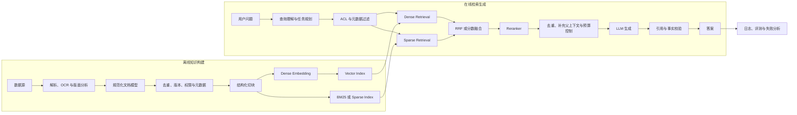
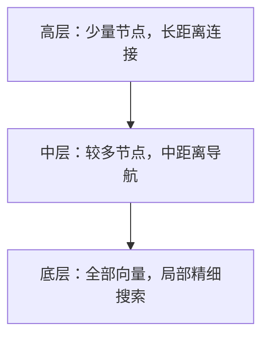

## 前言

Retrieval-Augmented Generation（RAG）将外部知识检索与语言模型生成结合起来。原始 RAG 论文把生成模型参数视为 parametric memory，把可检索的外部索引视为 non-parametric memory。工程上的 RAG 范围更广，通常包括数据同步、文档解析、权限控制、切块、索引、查询理解、候选召回、排序、上下文构造、生成、引用和评测。

RAG 让回答依赖可更新、可追溯的外部证据，而非模型参数中固化的知识。系统质量取决于整条证据链。解析阶段丢失表头、权限过滤错误或候选排序不当，都会在生成之前造成不可恢复的信息损失。

本文以企业研发知识库为主要场景。知识库包含 API 文档、技术方案、会议纪要、故障报告和多个历史版本，既有自然语言，也有错误码、接口名、版本号和表格等结构化内容。

## 1. RAG 的完整链路

RAG 分为离线知识构建和在线检索生成两条链路。



### 1.1 离线知识构建

数据接入需要处理增量同步、删除、版本、权限和索引版本，不能只实现一次性文件上传。每次解析和 embedding 都应记录模型与配置版本，以便重建索引和回溯线上问题。

规范化后的 chunk 至少包含以下信息：

```json
{
  "chunk_id": "payment-api:1.4:refund:03",
  "document_id": "payment-api",
  "text": "...",
  "section_path": ["退款接口", "部分退款"],
  "page": 12,
  "version": "1.4",
  "document_type": "api_spec",
  "updated_at": "2026-08-01T10:00:00Z",
  "allowed_principals": ["group:payment-rd"],
  "content_hash": "...",
  "parser_version": "...",
  "embedding_version": "..."
}
```

文本、向量和 metadata 必须能通过稳定 ID 关联。引用应指向原文页码、段落或坐标，而不是只返回向量库中的内部行号。

### 1.2 在线检索生成

在线查询通常经过以下步骤：

1. 提取问题中的实体、版本、时间和任务约束。
2. 根据用户身份执行权限过滤。
3. 选择 dense、BM25、文件搜索、树搜索或结构化查询。
4. 合并多路候选并重排。
5. 检查证据是否充分；不足时改写或拆解查询。
6. 在 token 预算内选择证据，生成带引用的答案。
7. 验证引用是否支持对应结论，记录完整执行轨迹。

一次向量 top-k 只能覆盖其中的候选召回环节，不能代表完整 RAG 系统。

## 2. 文档解析

PDF 保存的是页面绘制指令，不是语义文档结构。直接提取纯文本容易出现双栏顺序错乱、页眉页脚混入正文、表格拆散、脚注错配和扫描页为空等问题。

应根据源格式选择解析路径：

| 输入 | 建议路径 |
|---|---|
| 数字原生 PDF | 提取文本、字体、坐标和 block，恢复 reading order |
| 扫描 PDF 或图片 | 图像预处理、OCR、layout detection、置信度检查 |
| DOCX | 读取段落、样式、标题层级、表格和批注 |
| PPTX | 保留页面、文本框、层级、图表和 speaker notes |
| HTML | 使用 DOM、标题、列表和表格结构 |

DOCX、PPTX 和 HTML 应优先读取源格式，不宜先转换为 PDF。规范化文档模型需要保留元素类型、标题层级、页码、原文坐标和阅读顺序，使后续切块与引用仍能回到原始位置。

复杂表格需要同时保存结构化单元格和面向检索的文本形式：

```text
表名：退款接口错误码
列：错误码 | 含义 | 是否可重试
行：ERR_1042 | 原交易不存在 | 否
```

表名和列头应传播到每一行。图表可以保存标题、说明文字、所在章节和页面图像，在命中后交给视觉模型读取。

解析质量应通过空页面率、每页字符数、OCR 置信度、标题识别率、表格完整率、页眉页脚重复率和人工抽检来监控。许多表面上的 embedding 失败，根因是原文在解析阶段已经损坏。

## 3. Chunking

Chunk 是检索与重排的基本单元。它需要在检索粒度和证据完整性之间取舍：过大的 chunk 会稀释相关信号，过小的 chunk 又会丢失限定条件和上下文。

常见方法包括：

- 固定 token 长度与 overlap，可作为简单基线；
- recursive splitting，依次按章节、段落、句子和 token 切分；
- structure-aware chunking，按标题、API endpoint、代码函数、会议议题或故障阶段切分；
- semantic chunking，在相邻句子语义突变处切分；
- parent-child retrieval，用小块召回、用大块生成；
- proposition chunking，把段落拆成可独立检索的事实命题。

研发文档可以先采用结构优先、目标 300 至 600 tokens、最大约 800 tokens、10% 左右 overlap 的配置，并把标题路径作为 chunk 前缀。API 文档适合以 endpoint 或参数组为单位；会议纪要可按议题、决议和 action item 切分；故障报告可分别保存现象、时间线、根因和修复措施。

Parent-child retrieval 常用 200 至 400 tokens 的 child 负责召回，800 至 1500 tokens 的 parent 负责生成。Overlap 过大会产生大量近重复候选，需要在 rerank 后按 parent 或原文位置去重。

Chunk 大小应通过受控实验确定。除最终答案正确率外，还要比较 answer-containing chunk Recall@k、重复候选比例、引用定位精度和上下文 token 数。只调整 chunk 长度而不固定 embedding、检索器和测试集，无法判断变化来自哪里。

## 4. 文档权限与 ACL

ACL 是 Access Control List，即访问控制列表。文档或 chunk 的 ACL 记录哪些用户、用户组或角色可以读取内容。

```json
{
  "tenant_id": "company-a",
  "visibility": "restricted",
  "allowed_principals": [
    "group:payment-rd",
    "role:architect",
    "user:u_1024"
  ],
  "denied_principals": ["contractor:c_77"]
}
```

用户登录后，权限服务将其身份展开为 principal 集合：

```text
user:u_1001
group:payment-rd
role:engineer
tenant:company-a
```

检索条件要求租户相同、允许集合与用户 principal 有交集，同时不能命中拒绝集合。权限检查应在检索过程中完成，而不是在召回 top-k 后再删除无权结果。后置过滤会造成两个问题：无权内容可能进入缓存或日志；头部结果被删除后，剩余候选的召回率明显下降。

ACL 标签是权限系统在检索索引中的投影，不是权威数据源。用户离开项目或文档权限变化时，索引必须及时同步。模型不能参与最终授权判断，也不能通过提示词覆盖权限约束。

## 5. Dense embedding 与相似度

### 5.1 从可变长度文本到定长向量

Embedding 模型先生成逐 token 隐藏状态，再通过 pooling 得到定长向量：

```text
token sequence [T]
→ hidden states [T, d]
→ CLS、mean、last-token 或 attention pooling
→ embedding [d_e]
```

`CLS` 是 classification token 的缩写。BERT、XLM-R 等 encoder 模型会在序列开头插入特殊 token `[CLS]`。经过多层双向 self-attention 后，`[CLS]` 位置的 hidden state 可以汇集序列信息，再用于分类或生成整段文本的 embedding。这个位置并非天然就能概括全文；训练目标会促使模型把检索所需的信息写入其中。

Pooling 决定如何把 $T$ 个 token 表示压缩成一个向量：

| 方法 | 计算方式 | 常见模型或特点 |
|---|---|---|
| CLS pooling | 取 `[CLS]` 的最后一层 hidden state | BERT、XLM-R 类 encoder；BGE-M3 使用此方式 |
| Mean pooling | 对有效 token 的 hidden state 求平均 | 结果受所有 token 共同影响，需排除 padding |
| Last-token pooling | 取最后一个有效 token 的 hidden state | 适合经过检索训练的 decoder-only 模型；Qwen3-Embedding 使用此方式 |
| Attention pooling | 学习各 token 的聚合权重 | 表达灵活，但增加参数和计算 |

这里的“最后一个有效 token”指 padding 之前的最后一个真实 token。不同 pooling 方式对应不同训练过程，部署时不能随意替换。

输入可以是 10 个 token，也可以是 1000 个 token，输出维度保持不变。长文本因此存在信息瓶颈：支持长输入不等于其中每个细节都能在单一向量中保留。

常见 embedding 维度有 384、768、1024、1536、2560、3072 和 4096。BGE-M3 输出 1024 维 dense embedding。Qwen3-Embedding-0.6B、4B 和 8B 的最高维度分别为 1024、2560 和 4096；该系列支持 Matryoshka Representation Learning，可以截取较低维度。截断后需要重新进行 L2 normalization。

向量维度直接影响存储和计算。$N$ 个 $d_e$ 维 FP32 向量的原始存储量约为：

$$
4Nd_e\ \text{bytes}.
$$

一亿个 1024 维 FP32 向量仅原始数据约占 409.6 GB，尚未计算图索引、metadata 和副本。

### 5.2 Cosine、inner product 与 L2

Cosine similarity 为：

$$
\cos(x,y)=\frac{x^\top y}{\|x\|_2\|y\|_2}.
$$

平方欧氏距离为：

$$
\|x-y\|_2^2=\|x\|_2^2+\|y\|_2^2-2x^\top y.
$$

若 $x$、$y$ 都做过 L2 normalization：

$$
\|x\|_2=\|y\|_2=1,
$$

则：

$$
\|x-y\|_2^2=2-2x^\top y=2-2\cos(x,y).
$$

对于单位向量，最大化 cosine、最大化 inner product 和最小化 squared L2 会得到相同排序。工程实现中常用 inner product 索引计算归一化向量的 cosine 相似度。

未归一化时：

$$
x^\top y=\|x\|_2\|y\|_2\cos\theta.
$$

内积同时受方向和模长影响。通用文本检索通常希望相关性主要由方向表示的语义决定，因此会把向量投影到单位超球面。某些模型可能让模长携带置信度或频率信息，此时是否归一化要服从模型训练目标和官方推理约定，不能把 cosine 当成所有 embedding 的固定规则。

文本变长并不必然使向量模长变大。mean pooling 会对 token 表示求平均；CLS 和 last-token pooling 也不存在模长随序列长度单调增加的关系。归一化主要用于消除 magnitude 这个额外自由度，并让训练和推理使用一致的角度几何。

### 5.3 对比学习目标与训练样本记号

训练数据通常按 query 分组。本文使用以下记号：

| 记号 | 含义 |
|---|---|
| $q_i$ | 第 $i$ 个 query |
| $d_i^+$ | 与 $q_i$ 相关的正样本文档 |
| $d_{ij}^-$ | 为 $q_i$ 选取的第 $j$ 个负样本文档 |
| $\tau$ | 对比学习的 temperature |

$i$ 标识训练样本或 query，$j$ 标识同一 query 下的多个负样本，因此负样本写成 $d_{ij}^-$。上式假设每个 query 只有一个正样本；如果一个 query 有多个正样本，也可以写成 $d_{ip}^+$，其中 $p$ 是正样本编号。

给定这些训练样本，模型先计算 pooled representation，再进行归一化：

$$
h_q=f_\theta(q),\qquad h_d=f_\theta(d),
$$

$$
z_q=\frac{h_q}{\|h_q\|_2},\qquad
z_d=\frac{h_d}{\|h_d\|_2}.
$$

采用 temperature-scaled cosine score：

$$
s(q,d)=\frac{z_q^\top z_d}{\tau}.
$$

InfoNCE loss 的常见形式为：

$$
\mathcal L_i=-\log
\frac{\exp(s(q_i,d_i^+))}
{\exp(s(q_i,d_i^+))+\sum_j\exp(s(q_i,d_{ij}^-))}.
$$

训练使正样本方向靠近，负样本方向远离。归一化后，模型不能通过同时放大向量模长来降低损失，只能调整方向。$\tau$ 控制 softmax 分布的锐度，hard negatives 和 in-batch negatives 决定模型需要区分的难度。

BGE-M3 使用归一化的 `[CLS]` hidden state 作为 dense embedding；Qwen3-Embedding 使用 last-token pooling，并在官方推理实现中执行 L2 normalization。建库和查询必须采用相同的 pooling、instruction、截断维度和归一化方法。

## 6. BM25 与稀疏检索

BM25 根据查询词在文档中的出现情况计算相关性。它通常建立在倒排索引（inverted index）之上：与“给定文档，列出其中有哪些词”的正向结构相反，倒排索引为每个词保存包含该词的文档列表（posting list），并可在列表中记录该词在各文档中的出现次数、位置等信息。例如，词 `退款` 的 posting list 可以记录它出现在文档 A 和 C 中，以及在两篇文档中各出现了几次。查询到来时，系统只需读取查询词对应的 posting lists、合并候选文档并计算 BM25 分数，而不必逐篇扫描整个语料库。

BM25 的常见形式为：

$$
\operatorname{BM25}(D,Q)=
\sum_{t\in Q}
\operatorname{IDF}(t)
\frac{tf(t,D)(k_1+1)}
{tf(t,D)+k_1\left(1-b+b\frac{|D|}{avgdl}\right)}.
$$

逆文档频率可写为：

$$
\operatorname{IDF}(t)=
\log\left(1+\frac{N-df(t)+0.5}{df(t)+0.5}\right),
$$

其中，$tf(t,D)$ 是词 $t$ 在文档 $D$ 中出现的次数，$|D|$ 是文档 $D$ 的长度，$avgdl$ 是索引内全部文档的平均长度；文档长度通常以 analyzer 处理后的词项（term）数计算，因此它不一定等于原始字符数或模型 token 数。$N$ 是索引中的文档总数，$df(t)$ 是包含词 $t$ 的文档数。错误码 `ERR_REFUND_1042` 只出现在少量文档中，IDF 较高；“接口”等常见词的区分能力较弱。

词频项不是线性增长。一个词从出现一次增加到三次通常有明显收益，从一百次增加到一百零二次则影响很小。参数 $k_1$ 控制词频饱和速度，常用起点约为 1.2 至 2；$b$ 控制文档长度归一化，常用起点为 0.75。参数值应在业务验证集上调整。

BM25 的效果高度依赖 analyzer。中文知识库需要处理分词、英文大小写、同义词、下划线、连字符、版本号、错误码和 API 路径。若 analyzer 把一个完整错误码拆得无法复原，BM25 的精确匹配优势也会消失。

Dense retrieval 擅长同义表达和跨语言语义匹配；BM25 擅长错误码、接口名、数字和产品名。研发知识库通常同时需要两者。

## 7. 向量索引与 ANN

### 7.1 精确检索

精确检索会计算 query 与索引中全部向量的相似度，再选出 top-k。Faiss 的 `IndexFlatIP` 是一种典型实现，它按 inner product 从大到小返回结果：

- `Flat` 表示保存全部原始向量，不分区、不压缩；
- `IP` 表示按 inner product 从大到小返回结果；
- 索引无需训练；
- 单次查询需要扫描全部 $N$ 个 $d_e$ 维向量，复杂度为 $O(Nd_e)$。

对文档和查询向量进行 L2 normalization 后，`IndexFlatIP` 得到精确 cosine top-k：

```python
import faiss

faiss.normalize_L2(document_vectors)
faiss.normalize_L2(query_vectors)

index = faiss.IndexFlatIP(document_vectors.shape[1])
index.add(document_vectors)
scores, ids = index.search(query_vectors, k=10)
```

Flat 索引适合小数据、查询次数不多的场景，也适合生成 ANN 评测所需的 ground truth。

### 7.2 ANN 的目标与主要方法

Approximate Nearest Neighbor（ANN）不保证返回精确最近邻。它通过少扫描部分向量换取更低延迟和更高吞吐。

常见方法包括：

| 方法 | 基本思路 | 主要参数或代价 |
|---|---|---|
| IVF | 先聚类到倒排桶，只搜索部分桶 | `nlist`、`nprobe` |
| HNSW | 在分层近邻图上导航 | `M`、`efConstruction`、`efSearch` |
| PQ/SQ | 压缩向量并近似计算距离 | 内存下降，产生量化误差 |
| LSH | 用哈希碰撞近似邻近关系 | 依赖距离类型和数据分布 |

IVF 将向量分到 `nlist` 个聚类中心。查询只探测 `nprobe` 个桶，粗略扫描量约为：

$$
N\frac{nprobe}{nlist}.
$$

增大 `nprobe` 通常提高 recall，也增加延迟。PQ 把向量子空间量化为短码，减少内存和内存带宽，但会改变近邻排序。

ANN 没有统一的查询复杂度。数据分布、维度、索引参数和硬件都会影响实际性能。选型应比较 recall、P95 latency、吞吐和内存，而不是只引用渐近复杂度。

### 7.3 ANN recall 与业务 recall

以 Flat exact search 为基准：

$$
\operatorname{ANNRecall@k}=
\frac{|\operatorname{ExactTopK}\cap\operatorname{ANNTopK}|}{k}.
$$

它衡量 ANN 对精确向量搜索的近似程度。业务 Retrieval Recall 则衡量结果中是否包含真正相关的文档。二者不能混淆：ANN Recall 可以达到 99%，但 embedding 若不理解领域术语，业务召回仍然很差。

### 7.4 HNSW

Hierarchical Navigable Small World（HNSW）是分层近邻图。高层节点稀疏，负责远距离跳转；底层包含全部向量，负责局部搜索。



每个新向量随机获得一个最高层级，进入高层的概率按指数下降。建图时，节点在各层连接到一组近邻。查询从最高层入口出发，沿着更接近 query 的邻居移动；当前层无法继续改善时下降一层。底层使用 best-first search 维护候选集合，最后返回 top-k。

三个主要参数为：

| 参数 | 作用 | 增大后的影响 |
|---|---|---|
| `M` | 每个节点的图邻居数量 | recall 和内存上升，建图变慢 |
| `efConstruction` | 建图时的搜索宽度 | 图质量提高，建库时间增加 |
| `efSearch` | 查询时的搜索宽度 | recall 提高，查询延迟增加 |

通常要求 `efSearch >= k`。HNSW 查询在实际数据上经常表现出接近对数级的导航效率，但最坏情况仍可能退化为线性扫描，不能无条件写成严格的 $O(\log N)$。

HNSW 的图边会消耗较多内存，批量建库也比 Flat 慢。删除、频繁更新和严格 metadata filter 会增加实现难度。Faiss 的 `IndexHNSWFlat` 使用 HNSW 图导航，底层仍保存未压缩向量，因而精度较高、内存占用也较大。

## 8. 查询理解与检索规划

### 8.1 用检索操作表示任务

把用户问题映射为单一业务意图，很容易形成不断扩张的标签体系。事实查询、版本比较、会议总结和故障定位还可以继续细分，组合问题又可能同时属于多个类别。

更稳妥的表示方式是“少量操作 + 开放参数”。常见检索操作只有几类：

```text
retrieve
read
compare
aggregate
filter
trace
verify
```

问题“v1.3 到 v1.4 的退款接口有什么不兼容变化？”可以生成如下计划：

```json
{
  "operations": [
    {
      "type": "retrieve",
      "query": "退款接口",
      "filters": {"version": ["1.3", "1.4"]}
    },
    {
      "type": "compare",
      "group_by": "version",
      "focus": "backward_incompatibility"
    }
  ],
  "entities": {
    "module": "refund",
    "versions": ["1.3", "1.4"]
  }
}
```

`retrieve` 和 `compare` 是有限操作；模块名、版本和比较重点是开放参数。新增模块不需要增加新的意图类别。

### 8.2 规则、小模型与大模型的分工

规则适合抽取格式稳定、精确性要求高的字段，例如版本号、日期、工单号、错误码、API 路径和文件名：

```regex
\bv?(\d+\.\d+(?:\.\d+)?)\b
ERR_[A-Z_]+_\d+
/api/v\d+/[\w/-]+
```

大模型适合生成开放式检索计划，判断问题是否需要比较、多跳检索或证据验证。输出应受 JSON Schema 约束，并设置无法解析时的通用检索回退路径。

小模型适合承接高频且稳定的路由决策，例如判断是否需要检索、是否含精确标识符、是否需要版本比较。第一版系统通常不需要专门训练分类器。先使用规则与大模型积累日志，再将稳定决策蒸馏到小模型，成本更低，也更容易得到贴近实际流量的训练数据。

当 dense 和 BM25 的查询成本足够低时，可以始终执行两路检索，把路由问题交给融合与重排，避免分类错误向后传播。

## 9. 混合检索与候选融合

### 9.1 为什么需要混合检索

Dense embedding 可以把“容器为什么反复重启”和“服务因内存上限触发 OOMKilled”映射到相近位置，但可能忽略精确版本号或错误码。BM25 能精确找到 `refund_mode=PARTIAL`，却不能自然处理同义改写。

混合检索先由多种检索器扩大候选集，再统一排序。常见基线为：

```text
dense top 50～100
+ BM25 top 50～100
→ RRF
→ reranker
→ context top 5～12
```

候选深度、融合权重和最终上下文数量是不同参数，不能都称为 `top_k`。

### 9.2 Reciprocal Rank Fusion

BM25 和 cosine 分数不在同一尺度上，且不同查询的分数分布也会变化。Reciprocal Rank Fusion（RRF）只使用名次：

$$
\operatorname{RRF}(d)=
\sum_{r\in R}\frac{w_r}{k+\operatorname{rank}_r(d)}.
$$

$w_r$ 是检索器权重。一个文档若同时出现在 dense 和 BM25 的前列，会得到两路贡献。RRF 不要求训练数据，也不需要把不同检索器的原始分数校准到同一尺度。

RRF 中的 $k$ 是平滑常数，不是返回结果数。当 $k=10$ 时，第 1 名和第 10 名的贡献分别为 $1/11$ 和 $1/20$，头部差距较大；当 $k=60$ 时，两者为 $1/61$ 和 $1/70$，排名衰减更平缓。

较小的 $k$ 更信任单路检索的头部排序，较大的 $k$ 更重视多路共识。原论文使用的经典设置是 60，但实际系统应在验证集上搜索 $k\in\{10,20,40,60,100\}$，并同时调整候选深度和各路权重。若每路只返回 20 个候选，$k=60$ 可能过于平坦。

### 9.3 分数归一化与 z-score

分数加权融合可以写为：

$$
s(d)=\alpha\tilde{s}_{dense}(d)+(1-\alpha)\tilde{s}_{sparse}(d).
$$

其中，$\tilde{s}_{dense}$ 和 $\tilde{s}_{sparse}$ 分别表示经过尺度校准后的 dense 与 sparse 分数，而不是某一种固定公式的名称。Query 内 z-score 是得到 $\tilde{s}$ 的一种简单校准方法：对每一路检索器在当前 query 下的原始分数分别做 z-score 变换，并把变换结果直接作为该路的 $\tilde{s}$。若 $r\in\{dense,sparse\}$ 表示检索器、$d_i$ 表示第 $i$ 个候选，则关系可以明确写成：

$$
\tilde{s}_r(d_i)=z_{r,i}
=\frac{s_r(d_i)-\mu_{q,r}}{\sigma_{q,r}+\epsilon}.
$$

$\mu_{q,r}$ 和 $\sigma_{q,r}$ 分别是检索器 $r$ 对当前 query 返回的候选分数的均值和标准差。z-score 把原始分数转成“高于该路候选平均水平多少个标准差”，从而让两路分数更适合相加。它不是唯一选择；min-max normalization、基于标注数据学习的概率校准等方法也可以产生可比较的 $\tilde{s}$。

候选很少或分数过于集中时，$\mu_{q,r}$ 和 $\sigma_{q,r}$ 的估计不稳定。若分数是 `[0.801, 0.800, 0.799]`，很小的数值差异会因标准差过小而被放大。top-k 又是经过截断的样本，不代表完整分布。在缺少可靠校准数据时，RRF 通常比 query 内 z-score 稳定。

有足够标注数据后，可以训练 learning-to-rank 模型，直接学习如何组合 dense score、BM25 score、标题命中、版本匹配、文档类型和时间等特征。Logistic regression 是较简单的线性基线；LambdaMART 是基于梯度提升决策树的排序算法，它通过 LambdaRank 构造的梯度，让模型更直接地优化 nDCG 等排序指标，尤其适合表格化特征；神经 ranker 则使用神经网络学习相关性函数，例如让 cross-encoder 联合读取 query 和候选文本后输出相关性分数。三者都不同于手工设置固定融合权重：它们需要带相关性标签或偏好信息的训练数据，并从数据中学习排序规则。

### 9.4 动态权重

动态权重不一定需要训练查询分类器。实现可以分为四级：

1. 使用全局固定权重作为基线。
2. 通过规则识别错误码、API 路径和版本号，提高 sparse 权重。
3. 让 LLM planner 选择检索器和权重。
4. 积累标注后训练 multi-label router 或 learning-to-rank 模型。

如果两路检索成本低，始终执行 dense 和 BM25 往往比前置分类更稳。分类器一旦路由错误，正确检索器根本没有机会产生候选。

## 10. Rerank 与上下文构造

### 10.1 为什么召回后还要重排

Dense retriever 通常是 bi-encoder：query 与文档分别编码，最终只用两个向量的点积计算相关性。文档向量可以离线预计算，查询速度快，但 query token 和文档 token 在编码时没有直接交互，否定、数字、版本和多条件约束容易丢失。

Cross-encoder 联合编码 query 和候选文档：

```text
[CLS] query [SEP] document [SEP] → relevance score
```

完整 token-level attention 通常能得到更准确的相关性判断，代价是每个 query-document pair 都要单独推理。常用的两阶段结构为：

```text
快速召回 50～100 个候选
→ cross-encoder 重排
→ 选择 5～12 个证据块
```

Rerank 主要修正四类误差：ANN 的近似误差、单向量表示瓶颈、多路融合无法表达的细粒度条件，以及召回结果中的重复与噪声。

其他重排方法包括 ColBERT 一类 late interaction、LLM pointwise/pairwise/listwise ranking，以及结合版本、新鲜度、文档权威性等业务特征的 ranker。权限不能作为普通加权特征，必须是硬过滤条件。

### 10.2 Context construction

重排完成后还需处理：

- 合并相邻或重叠 chunk；
- 限制同一文档占据的候选数量；
- 为多证据问题保留来源多样性；
- child chunk 命中后补充 parent section；
- 把强证据放在上下文前部；
- 在 token 预算内保留标题、版本和引用定位。

上下文窗口足够长也不应直接塞入全部候选。无关材料会增加费用，并可能让模型忽略位于中部的有效证据。

## 11. Vectorless RAG、Agentic RAG 与源文件搜索

### 11.1 两个相互独立的分类维度

Vectorless 与 Agentic 描述的不是同一个维度：

- vectorless 描述“用什么表示和检索知识”，即不依赖 dense vector index；
- agentic 描述“谁决定下一步检索动作”，即由模型根据当前状态动态规划。

一个系统可以同时使用向量检索和 Agent，也可以使用树检索但保持固定流程。直接搜索源文件只有在模型能够反复选择 `list`、`grep`、`read` 等操作时，才属于 agentic retrieval；固定执行一次 `grep` 的脚本不属于 Agent。

| 方案 | 主要检索机制 | 控制流 | 是否使用 dense vector | 适用问题 | 主要限制 |
|---|---|---|---|---|---|
| Naive RAG | 固定切块后的向量 top-k | 一次固定调用 | 通常使用 | 简单事实问答、快速原型 | 难处理多跳、版本和结构关系 |
| 传统生产 RAG | Dense、BM25、过滤、RRF、rerank | 预定义 pipeline 或 DAG | 通常使用 | 高频问答、延迟敏感、可重复评测 | 检索路径缺少动态调整 |
| Vectorless RAG | BM25、目录树、SQL、图或全文索引 | 固定或动态均可 | 不使用 | 长文档导航、精确查询、结构化数据 | 语义召回和跨文档扩展能力取决于具体索引 |
| Agentic retrieval | Agent 选择并循环调用多种工具 | 动态循环 | 可用可不用 | 多跳研究、比较、诊断和开放式任务 | 成本、延迟和执行方差较高 |
| Agentic source search | `list`、`find`、`grep`、`read`、AST/LSP | 动态循环 | 通常不用，也可辅助使用 | 代码仓库、已知文件集、精确符号追踪 | 模糊语义检索和超大规模扫描较弱 |

“传统 RAG”也需区分 naive 实现与完整生产 pipeline。混合检索、重排、权限过滤和引用校验都可以放在固定流程中，不要求 Agent 参与。

### 11.2 传统生产 RAG

传统生产 RAG 使用预定义控制流。每个查询依次经过 query rewriting、metadata filter、候选召回、融合、rerank 和生成；各步骤可以很完善，但系统不会根据中间证据临时增加新的检索步骤。

```text
query
→ 固定 query rewrite
→ dense + BM25
→ RRF
→ cross-encoder
→ 固定数量的 context
→ generation
```

固定 pipeline 的延迟和成本容易估算，执行轨迹也便于回放。FAQ、产品手册问答、客服知识库等高频单跳任务通常先采用这种结构。它的局限出现在开放式任务：如果第一次召回缺少某个版本，pipeline 仍会继续生成；如果答案需要先找到服务名、再查询该服务的故障记录，固定的一次检索无法根据第一步结果构造第二步查询。

传统 RAG 并不低级。对大量边界清楚的线上问答，它往往比 Agent 更稳定，也更容易满足 P95 延迟和成本约束。是否引入动态循环，应由多跳问题比例和失败分析决定。

### 11.3 Vectorless RAG 的技术路线

Vectorless RAG 并非没有索引，而是不用 dense embedding 表示每个检索单元。常见路线如下。

#### 层次树检索

系统根据目录、标题、页码和章节摘要建立树：

```text
文档
├── 1. 系统概述 [p1-p8]
├── 2. API 规范 [p9-p42]
│   ├── 2.1 支付 [p10-p21]
│   └── 2.2 退款 [p22-p35]
└── 3. 迁移指南 [p43-p58]
```

[PageIndex 文档](https://docs.pageindex.ai/)把这一方法描述为：先为文档建立树结构，再通过 reasoning-based traversal 定位证据。查询时，模型阅读高层节点的标题和摘要，选中相关分支并逐层下钻，最后读取原始页或段落。

树检索保留章节关系，引用路径也很清楚。它适合财报、法规、技术手册和长篇设计文档。索引质量依赖目录恢复与节点摘要；文档没有稳定结构时，树可能只是另一种噪声表示。跨数十万份文档搜索时，还需要先做文件级召回，否则逐棵树遍历的成本过高。

#### 全文、规则与字段检索

BM25、SQLite FTS、Elasticsearch、正则表达式和倒排索引都属于 vectorless retrieval。错误码、合同条款号、API 路径和人名等查询通常不需要 dense embedding。

对于已知 schema 的业务数据，应优先使用 SQL 或 API：

```text
“本周关闭了多少个 P1 工单？”
→ 查询工单系统的结构化字段
```

把工单行转成自然语言、切块并做向量搜索，会损失聚合精度和数据新鲜度。

#### 图检索

知识图谱、代码调用图和文档引用图通过节点与边表达关系。问题“哪些服务依赖被废弃的认证接口”可以从接口节点沿 `called_by` 边反向遍历。图检索对多跳关系有效，但实体消歧、关系抽取和图更新的成本较高。

#### Vectorless 的收益与代价

它省去 embedding 计算和向量重建，更新后的文档可以直接使用全文或结构索引。树、字段和图还能保留明确的导航路径。代价是语义改写、跨语言和模糊概念检索较弱；若每个树节点都让大模型判断，在线成本也可能高于向量召回。

因此，vectorless 更适合有明确结构、精确标识符或可查询 schema 的数据。面对大量非结构化短文档时，它通常是 dense retrieval 的补充，而不是默认替代品。

### 11.4 Agentic retrieval 的执行模型

Agentic retrieval 把固定的一次检索改为带状态循环。状态中至少包含：

```json
{
  "question": "...",
  "constraints": {},
  "subquestions": [],
  "evidence": [],
  "missing_information": [],
  "visited_sources": [],
  "step": 0,
  "token_budget": 12000
}
```

一次循环可以表示为：

```text
根据问题和已有证据选择工具
→ 校验参数与权限
→ 执行检索或读取
→ 记录结果和来源
→ 判断证据充分性
→ 继续、改写、拆解或停止
```

Agentic retrieval 常用以下技术：

- query decomposition：把跨文档问题拆成可独立检索的子问题；
- query rewriting：根据空结果、歧义或领域术语生成新的检索表达；
- tool routing：在 dense、BM25、树搜索、`grep`、SQL 和外部 API 之间选择；
- corrective retrieval：低相关或相互冲突时更换检索器、扩大范围或读取原文；
- evidence sufficiency：判断当前证据能否覆盖结论中的每个要点；
- source verification：回到原文检查摘要、引用和版本；
- budgeted search：根据剩余步骤、token、费用和延迟决定是否继续。

不同任务对应的检索轨迹可以明显不同：

| 任务 | 可能的检索轨迹 |
|---|---|
| 版本兼容性调查 | 分别检索 v1.3、v1.4 → 比较字段 → 搜索迁移指南 → 读取旧客户端调用点 |
| 线上故障归因 | 提取错误码 → 查运行手册 → 查近期变更 → 读取监控或工单 → 验证时间线 |
| 需求冲突检查 | 检索产品需求 → 检索 API 约束 → 搜索会议决议 → 标出矛盾结论和来源 |
| 代码影响分析 | 找 symbol 定义 → 查引用与调用图 → 读取测试 → 必要时运行测试 |

固定的一次 top-k 很难预先覆盖这些路径。Agent 在每一步读取新实体，再据此构造下一次查询。

Agent 的充分性判断不能只问模型“资料够不够”。更可靠的做法是把任务拆成检查项：

```text
是否拿到两个指定版本？
是否定位到字段级差异？
是否找到旧客户端实际使用的字段？
结论是否有对应来源？
```

系统还需设置最大步骤数、单工具超时、费用上限、重复查询检测和停止原因。否则空结果可能触发无休止的 query rewriting。[Agentic RAG Survey](https://arxiv.org/abs/2501.09136)总结了这类系统的架构与常见模式，可作为设计动态检索循环时的进一步参考。

### 11.5 直接搜索源文件

源文件搜索是一组检索工具，不是独立于 agentic retrieval 的控制范式。当 Agent 根据中间结果自主执行多轮 `list`、`find`、`grep`、`read_range`、AST 或语言服务器查询时，它是 agentic retrieval 的一个子集。

代码仓库尤其适合这种方式。代码具有文件名、symbol、import 和调用关系，可以按以下路径调查：

```text
rg 搜索接口名
→ 读取定义与调用点
→ 用 AST/LSP 找引用
→ 沿调用链查看配置和测试
→ 运行测试验证推断
```

对已知文件的精读也适合直接读取。例如已经定位到 `payment-api-v1.4.md` 后，继续使用向量搜索找其中的参数定义，通常不如在文件内按标题或关键词定位。

源文件搜索不适合承担全部召回工作。`grep` 无法自然匹配同义表达，逐文件扫描也不能扩展到百万级语料。PDF、PPTX 和扫描件在进入文件工具前仍需转换成结构化、可寻址的表示。

### 11.6 Retrieval harness

较完整的系统会向 Agent 暴露少量、边界清楚的检索工具：

```text
list_sources(scope)
find_files(name_or_metadata)
grep_file(file_id, pattern)
read_range(file_id, start, end)
hybrid_retrieve(query, filters, top_k)
navigate_tree(document_id, node_id)
query_structured(source, query)
verify_citation(source_id, span)
```

`hybrid_retrieve` 用于大范围高召回，`grep_file` 和 `read_range` 用于命中后的精确定位，树和 SQL 处理各自擅长的数据结构。Agent 负责调度，工具负责权限、执行和可重复的结果。[LlamaIndex 对 Retrieval Harness 的介绍](https://www.llamaindex.ai/blog/announcing-retrieval-harness)也采用“混合检索加文件系统原语”的组合，而不是在向量库和源文件搜索之间二选一。

## 12. 向量库与索引选型

Faiss 是向量检索库；Milvus 和 Qdrant 是向量数据库服务。三者的系统边界不同。

| 维度 | Faiss | Milvus | Qdrant |
|---|---|---|---|
| 定位 | C++/Python ANN 库 | 分布式向量数据库 | 向量搜索数据库 |
| 部署 | 嵌入应用进程 | Lite、Standalone、Kubernetes | 单机、集群或云服务 |
| 强项 | 算法控制、GPU、精确基线 | 大规模、计算存储分离、多索引类型 | Payload filtering、HNSW、API 易用性 |
| 数据库能力 | 需自行实现 | 完整 | 完整 |
| Hybrid retrieval | 应用层实现 | 支持 dense、sparse 与多向量 | 支持 dense、sparse 与多阶段查询 |
| 适用场景 | 研究、离线实验、单机服务 | 大规模、高吞吐、已有 K8s 平台 | 过滤复杂、快速生产落地 |

数据规模在几十万至几百万 chunks 时，不应仅因未来可能增长而直接引入复杂分布式系统。单机 Qdrant、Milvus Standalone、PostgreSQL 加 pgvector，甚至应用内 Faiss 都可能满足需求。若现有 Elasticsearch/OpenSearch 已承载 BM25、权限和业务过滤，也应评估在原有搜索栈上增加向量能力。

## 13. 检索与生成评测

### 13.1 Recall@k 与 Hit@k

设相关文档集合为 $R_q$，前 $k$ 个检索结果为 $L_q^k$：

$$
\operatorname{Recall@k}(q)=
\frac{|R_q\cap L_q^k|}{|R_q|}.
$$

若相关集合为 `{A, C, F, H}`，top-5 为 `[A, B, C, D, E]`，则 Recall@5 为 $2/4=0.5$。

问答任务有时只要求前 $k$ 中至少出现一个可回答证据，此时更准确的指标是 Hit@k：

$$
\operatorname{Hit@k}(q)=
\mathbb 1[R_q\cap L_q^k\neq\varnothing].
$$

评测报告应说明相关性单位是文档、chunk 还是任一可回答证据，避免把 Hit@k 与严格 Recall@k 混用。

### 13.2 nDCG@k

nDCG 同时考虑相关程度和排名位置：

$$
\operatorname{DCG@k}=
\sum_{i=1}^{k}\frac{2^{rel_i}-1}{\log_2(i+1)},
$$

$$
\operatorname{nDCG@k}=
\frac{\operatorname{DCG@k}}{\operatorname{IDCG@k}}.
$$

`IDCG@k` 是理想排序的 DCG。这里的 $rel_i$ 是排在第 $i$ 位的结果相对于当前 query 的相关性等级（relevance grade），不是由 DCG 公式自动计算出来的分数。它通常来自人工标注或既有 qrel 数据：例如约定 `0` 表示不相关、`1` 表示弱相关、`2` 表示部分相关、`3` 表示高度相关，再由标注指南判断每个 query-document（或 query-chunk）对属于哪一级。也可以通过点击、停留、采纳等行为信号推断等级，但这些弱标签应先做偏差校正和质量验证。若有多名标注者，应预先定义冲突处理规则，例如取多数意见或由专家复核；同一套等级定义必须同时用于 DCG 和 IDCG。

若前三个结果的相关性等级为 `[3, 0, 2]`：

$$
\operatorname{DCG@3}=7+0+\frac{3}{2}=8.5.
$$

理想顺序 `[3, 2, 0]` 的：

$$
\operatorname{IDCG@3}=7+\frac{3}{\log_2 3}\approx8.893,
$$

所以 nDCG@3 约为 0.956。二元相关性可以令 $rel_i\in\{0,1\}$；有强相关、部分相关和不相关标注时，分级 nDCG 更有区分力。

### 13.3 端到端指标与错误分类

检索指标之外，还应评估：

- answer correctness；
- faithfulness，即答案是否被证据支持；
- citation precision 与 citation recall；
- 无答案问题的 abstention；
- 版本或来源冲突的识别率；
- P50/P95 延迟、token 与模型费用；
- 索引新鲜度、ACL 泄漏率和解析失败率。

失败应按链路分类：

```text
解析错误
→ chunk 边界错误
→ metadata 或 ACL 错误
→ 候选召回错误
→ 融合错误
→ rerank 错误
→ context 构造错误
→ 模型未使用证据
→ 引用错误
→ 知识缺失或冲突
```

只看最终回答是否“像是正确的”，无法判断应修改 embedding、索引、reranker 还是生成提示词。

## 14. 企业研发知识库的基线方案

假设知识库包含一百万个中英文 chunk，大量内容带有接口名、错误码和版本号，每小时同步一次，并按项目和部门控制权限。可采用以下起始配置：

```text
源格式解析，PDF 使用 OCR/layout fallback
→ 保留标题、页码、表格、版本和 ACL
→ 结构化 chunking，目标 300～600 tokens
→ multilingual dense embedding + BM25
→ 为 project、version、doc_type、ACL 建 metadata index
```

在线链路为：

```text
规则抽取版本、错误码等硬实体
→ LLM 生成检索计划
→ ACL 与版本过滤
→ dense top 80 + BM25 top 80
→ weighted RRF，初始 k=40～60
→ cross-encoder rerank 50～100 个候选
→ 去重并补充 parent context
→ 选择 6～10 个证据块
→ 带引用生成与引用校验
```

这些数值只用于建立实验起点。最终参数应通过 BM25-only、dense-only、hybrid、hybrid-plus-reranker 等消融实验确定，并分别报告检索质量、端到端正确率、延迟和成本。

## 参考资料

- [Retrieval-Augmented Generation for Knowledge-Intensive NLP Tasks](https://arxiv.org/abs/2005.11401)
- [Dense Passage Retrieval for Open-Domain Question Answering](https://arxiv.org/abs/2004.04906)
- [Reciprocal Rank Fusion Outperforms Condorcet and Individual Rank Learning Methods](https://doi.org/10.1145/1571941.1572114)
- [ColBERT: Efficient and Effective Passage Search via Contextualized Late Interaction over BERT](https://arxiv.org/abs/2004.12832)
- [BGE-M3 Embedding](https://arxiv.org/abs/2402.03216)
- [Qwen3 Embedding](https://arxiv.org/abs/2506.05176)
- [The Probabilistic Relevance Framework: BM25 and Beyond](https://doi.org/10.1561/1500000019)
- [Efficient and Robust Approximate Nearest Neighbor Search Using HNSW](https://arxiv.org/abs/1603.09320)
- [Faiss Documentation](https://faiss.ai/)
- [Faiss Indexes](https://github.com/facebookresearch/faiss/wiki/Faiss-indexes)
- [Agentic Retrieval-Augmented Generation: A Survey](https://arxiv.org/abs/2501.09136)
- [Lost in the Middle: How Language Models Use Long Contexts](https://arxiv.org/abs/2307.03172)
- [PageIndex Documentation](https://docs.pageindex.ai/)
- [LlamaIndex Retrieval Harness](https://www.llamaindex.ai/blog/announcing-retrieval-harness)
- [Milvus Architecture Overview](https://milvus.io/docs/architecture_overview.md)
- [Qdrant Hybrid Queries](https://qdrant.tech/documentation/search/hybrid-queries/)
